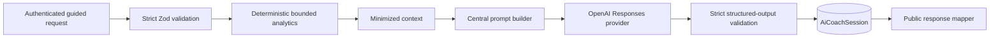
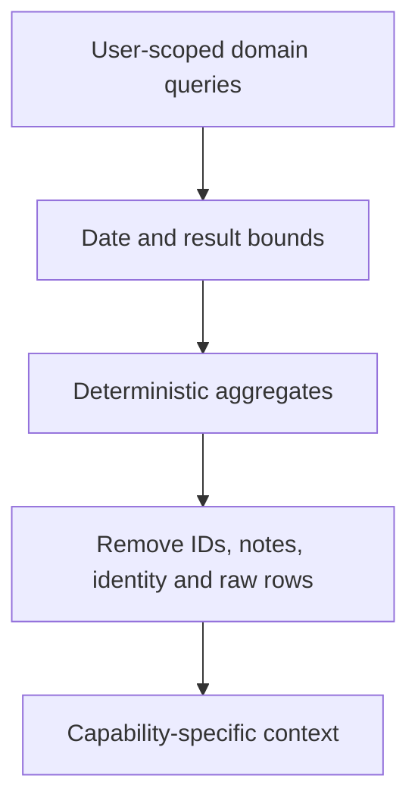
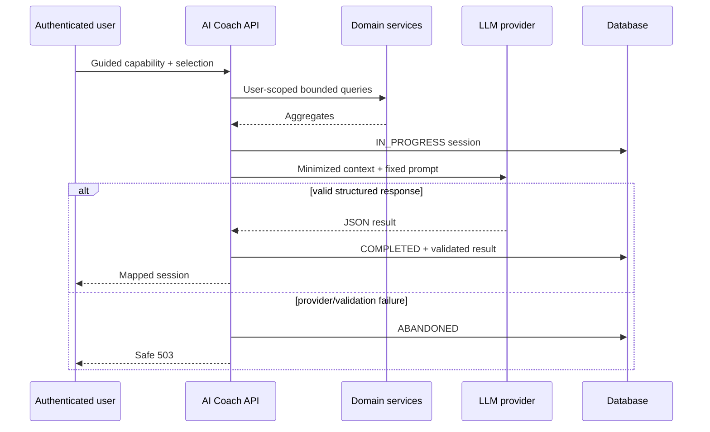

# AI Coach Backend V1

## Scope and routes

AI Coach V1 is an authenticated, guided analytics interpreter. It is not an arbitrary chat endpoint. The module exposes:

- `GET /api/v1/ai-coach/capabilities`
- `POST /api/v1/ai-coach/sessions`
- `GET /api/v1/ai-coach/sessions`
- `GET /api/v1/ai-coach/sessions/:sessionId`

The stable capabilities are progress analysis, plateau detection, workout-plan review, next-workout guidance, nutrition review, and weekly summary. User-facing explanations may be requested in English (`en`) or Arabic (`ar`); machine-readable codes remain stable.

## Architecture



Routes and controllers adapt HTTP only. Context builders reuse the Dashboard, Weight Tracker source-history, Nutrition, Profile, and Workout Plans domains. Pure analytics classify bounded data before an LLM sees it. The provider interface isolates the official OpenAI SDK, enabling network-free tests.

## Capability input requirements

| Capability              | Required selection               |
| ----------------------- | -------------------------------- |
| `PROGRESS_ANALYSIS`     | none                             |
| `PLATEAU_DETECTION`     | exercise or owned custom machine |
| `WORKOUT_PLAN_REVIEW`   | owned or public workout plan     |
| `NEXT_WORKOUT_GUIDANCE` | exercise or owned custom machine |
| `NUTRITION_REVIEW`      | none                             |
| `WEEKLY_SUMMARY`        | none                             |

Request bodies are strict. Arbitrary prompts, user IDs, unknown fields, and unsupported capability/selection combinations are rejected.

## Context minimization and data windows

The LLM receives only capability-relevant aggregates. Source analysis uses at most 12 bounded chart points. General progress, nutrition, and body-weight context uses a 90-day window where applicable. Weekly summaries use Monday-based UTC week boundaries.

The context excludes full name, email, authentication data, profile text, workout/session notes, plan notes, raw exercise sets, full histories, internal session IDs, raw prompts, and provider response identifiers. Exercise or plan labels may be included because they are required to make the selected analysis understandable.



## Persistence and history

The existing `AiCoachSession` schema is sufficient; no migration is required. `answers` stores a versioned guided request selection and minimized analytics context. `recommendations` stores the validated result plus analytics and coach versions. Successful sessions are `COMPLETED`. Provider or structured-output failures mark the session `ABANDONED`; no raw provider output is saved. History is user-scoped, paginated (maximum 50), sortable, and filterable by capability, status, and date range.

No prompt text, provider request ID, raw response, stack trace, API key, email, or auth metadata is returned by the public mapper.

## Deterministic analytics ownership

- Dashboard retains ownership of overview, body-weight trend, weekly comparison, and strength-progress analytics.
- Weight Tracker retains ownership of representative-weight and source-history semantics.
- Nutrition retains ownership of all calorie and macro formulas and saved results.
- Workout Plans retains ownership of plan visibility and nested plan data.
- Profile retains ownership of derived age and goal context.
- AI Coach adds only bounded classifications and structural aggregates needed for interpretation. It never recalculates nutrition formulas or mutates source domain data.

Plateau and next-workout classifications are intentionally conservative. Insufficient data is a valid context state. The model is forbidden from inventing exact loads or absent measurements.

## Provider configuration and failures

Configure both variables together:

```text
OPENAI_API_KEY=...
AI_COACH_MODEL=...
```

The model name is environment-owned and never hardcoded. The official OpenAI Node SDK uses the Responses API with strict JSON Schema, a 20-second timeout, no automatic retries, a bounded output token limit, and `store: false`. Generation is rate-limited independently of read endpoints. Missing configuration, timeout, refusal, malformed JSON, or schema-invalid output produces a safe `503` and an `ABANDONED` session. API keys and raw failures are never logged or returned.

## Security and privacy

Authentication precedes all routes. The authenticated token is the only source of user scope. Custom machines must belong to the user; workout plans must be owned or public; session detail/history is owner-only. The API never accepts a user ID. Existing exercise history visibility semantics are preserved.



## Testing

Integration tests replace the provider through a test-only override and never call the network. Unit tests cover plateau thresholds, next-workout direction, insufficient-data behavior, and output schema rejection. Integration coverage includes authentication, stable capabilities, generation/persistence, pagination/filtering, cross-user session access, custom-machine ownership, arbitrary-field rejection, and safe provider failure.

## Known limitations and V2 extensions

- V1 has no conversational memory, free-form chat, streaming, tools, embeddings, vector database, retrieval, or background jobs.
- Exercise selection follows existing source-history access semantics; global exercise history may remain analyzable after publication changes.
- The three-status Prisma enum has no dedicated `FAILED`; `ABANDONED` represents terminal provider/validation failure.
- Provider reliability is fail-fast. A future queued architecture may add controlled retries and idempotency without changing analytics ownership.
- A future AI Coach frontend should render only returned structured fields, use capability discovery, preserve Arabic/LTR/RTL behavior, and never offer arbitrary prompt input.

V2 can add conversations only through a new explicitly scoped contract. Retrieval, streaming, and tool calling should remain behind provider/domain interfaces and must preserve context minimization, user scoping, and structured validation.
