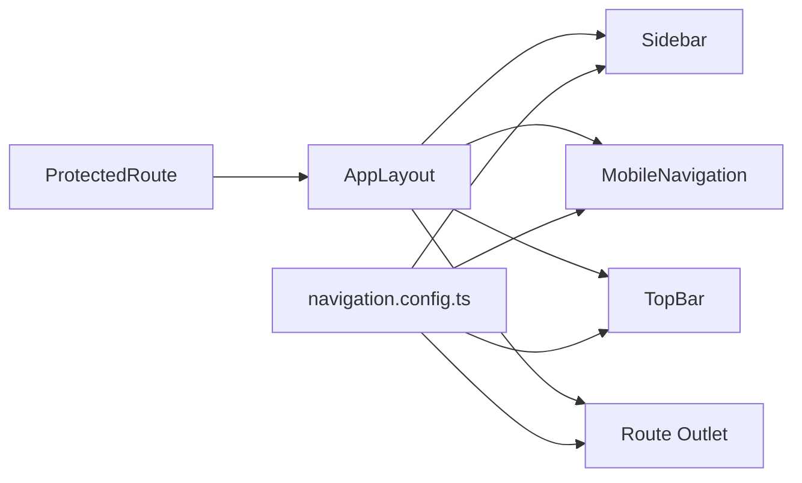

# Authenticated application shell

## Architecture

The authenticated shell is a nested React Router boundary. `ProtectedRoute` performs authentication enforcement, then `AppLayout` renders the shared interface and an `Outlet` for the selected page.

The Zustand authentication store remains the only source for the current user and logout action. Drawer state is local to the layout through `useMobileNavigation`; it is not global application state.

## Route map

| Route            | Navigation ID | Current content                 |
| ---------------- | ------------- | ------------------------------- |
| `/app`           | `home`        | Dashboard placeholder           |
| `/app/weights`   | `weights`     | Weight Tracker placeholder      |
| `/app/exercises` | `exercises`   | Exercise Videos placeholder     |
| `/app/ai-coach`  | `aiCoach`     | AI Coach placeholder            |
| `/app/calories`  | `calories`    | Calories Calculator placeholder |
| `/app/plans`     | `plans`       | Workout Plans placeholder       |
| `/app/profile`   | `profile`     | Profile placeholder             |

Unknown `/app/*` paths render `AppNotFoundPage` inside the shell. Unknown routes outside `/app` continue to use the public not-found boundary.

## Component responsibilities

- `AppLayout` composes the shell and owns no authentication or feature logic.
- `Sidebar` renders persistent desktop navigation and the user summary.
- `MobileNavigation` renders the modal drawer and keeps keyboard focus inside it.
- `TopBar` renders the resolved page title, compact user summary, menu trigger, and logout action.
- `NavigationList` and `NavigationItem` render the single typed navigation configuration.
- `UserSummary` centralizes nullable user-name handling and initials.
- `PageHeader` and `PlaceholderPage` centralize placeholder presentation.
- `useMobileNavigation` owns drawer state, Escape handling, route-change close, body scroll locking, and trigger focus restoration.

## Responsive behavior

At the `lg` breakpoint and above, the sidebar is fixed at 18rem and the application column is offset by the same width. Below `lg`, the sidebar is hidden and the toolbar exposes a menu button. The mobile drawer uses a modal overlay, locks body scrolling, focuses its close button, traps Tab navigation, closes on Escape or route change, and restores focus to its trigger.

No JavaScript media-query state is required; Tailwind controls which navigation surface is visible. This avoids duplicated responsive state and hydration differences.

## Accessibility decisions

- A focus-revealed skip link targets the focusable `#main-content` region.
- Navigation uses semantic `nav` and list elements.
- React Router supplies `aria-current="page"` to the active `NavLink`.
- Menu controls use explicit accessible names and dialog relationships.
- The drawer is labelled, modal, keyboard closable, focus-contained, and restores focus.
- All interactive elements have visible lime focus indicators.
- Decorative icons and placeholder surfaces are hidden from assistive technology.

## Adding a future feature page

1. Add or update its path, label, title, description, and icon in `src/config/navigation.config.ts`.
2. Add the nested route under `/app` in `src/routes/AppRoutes.tsx`.
3. Replace the route's `FeaturePlaceholderPage` with the real focused page component.
4. Keep product data fetching and business state inside that feature's own module; do not move it into `AppLayout` or navigation components.
5. Add route-level behavior tests. Do not assert Tailwind class strings.

The sidebar, drawer, active state, and top-bar title will update from the same navigation entry. Do not create a second navigation array or a separate page-title map.

## Debugging

- If a link is absent everywhere, inspect `appNavigationItems` first.
- If a link works but the page title says “Page not found,” ensure its configured absolute path matches the nested route URL exactly.
- If an authenticated route redirects to login, inspect `isAuthenticated` after `AuthInitializer` completes; do not bypass `ProtectedRoute`.
- If the drawer remains open after navigation, verify navigation uses `NavigationList` with the supplied `onNavigate` callback.
- If page content appears beneath the desktop sidebar, preserve the matching `w-72` and `lg:pl-72` layout values.

## Intentionally postponed

The shell contains no analytics, charts, trackers, calculations, coaching flows, plan-building tools, profile editing, notifications, search, or theme switching. Placeholder blocks contain no fabricated metrics or product data.
