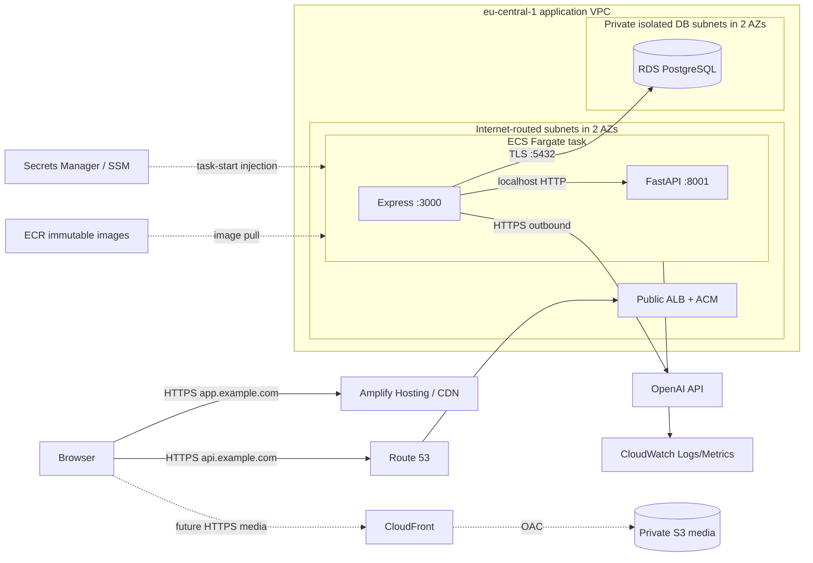

# AWS Architecture and Staging Deployment Plan

Status: planning decision record only  
Price and service-availability snapshot: 2026-08-08  
Primary workload region: Europe (Frankfurt), `eu-central-1`  
Deployment authorization: **not granted**

This document does not create or authorize AWS resources, credentials,
containers, infrastructure as code, CI workflows, DNS, or deployments. It
preserves the frozen Research Preview and evidence protocols.

Current account baseline: root MFA and daily-use `metaform-admin` IAM-user MFA
are enabled, an AWS Budget exists, and temporary MFA CLI sessions use the local
`metaform` profile. AWS Organizations and IAM Identity Center are deferred while
the current Free Plan/credits are preserved. No account number, credential, MFA
identifier, or local credential file belongs in this repository. GitHub OIDC
with short-lived roles remains the future CI/CD identity target.

## 1. Executive recommendation

Use a compact ECS-on-Fargate architecture for the regional application tier:

- Host the Vite SPA with **AWS Amplify Hosting** and its managed CDN/HTTPS.
- Route `api.<domain>` through Route 53 and an internet-facing Application Load
  Balancer (ALB) with an ACM certificate in `eu-central-1`.
- Run **one ECS service and one Fargate task definition containing two separate
  containers**: Express and FastAPI. Express is the only ALB target. It reaches
  FastAPI at `http://127.0.0.1:8001` inside the task.
- Run PostgreSQL on private, non-public **Amazon RDS for PostgreSQL**.
- Store runtime secrets in **Secrets Manager** and non-secret configuration in
  ECS task configuration or standard **SSM Parameter Store** parameters.
- Store future media in a private S3 bucket and publish it only through a
  CloudFront distribution using Origin Access Control (OAC).
- Send bounded-retention container logs and a small alarm set to CloudWatch.
- Use GitHub OIDC and short-lived deployment roles in a later implementation;
  never create long-lived repository access keys.

This is a compact form of Option B with the cost and networking simplification
requested by Option C. It retains separate Node and Python processes/images but
uses one task as their scaling and failure boundary. AWS confirms that
containers in one `awsvpc` task communicate over `localhost` in its
[Fargate networking documentation](https://docs.aws.amazon.com/AmazonECS/latest/developerguide/fargate-task-networking.html).

The recommended low-cost network deliberately has **no NAT Gateway**. Fargate
tasks use public subnets and one public IPv4 address per running task for ECR,
AWS APIs, and OpenAI egress. The task security group accepts port 3000 only from
the ALB security group; it accepts no internet source CIDR, and FastAPI has no
public port mapping. AWS documents both the public-IP image-pull design and the
private-subnet/NAT alternative in its
[Fargate task guidance](https://docs.aws.amazon.com/AmazonECS/latest/developerguide/fargate-tasks-services.html).

This design is production-minded but not initially highly available. Staging
uses one task and Single-AZ RDS. Low-traffic portfolio production may start
with one task and Single-AZ RDS after the owner explicitly accepts restart/AZ
interruptions. Two tasks and Multi-AZ RDS are the defined high-availability
upgrade, not an unmentioned default cost.

## 2. Current application architecture

### Components and runtime requirements

| Component           | Verified repository behavior                                                                             | Deployment requirement                                                      |
| ------------------- | -------------------------------------------------------------------------------------------------------- | --------------------------------------------------------------------------- |
| React/Vite frontend | Static SPA; only `VITE_API_URL` is public; 19 lazy routes; largest lazy chunk 350.26 kB                  | Static files, SPA fallback, HTTPS, immutable hashed-asset caching           |
| Express API         | Node >=22.12; `node dist/server.js`; port 3000 default; graceful SIGTERM and 10-second shutdown deadline | Long-running supervised process, one controlled proxy, health checks        |
| Prisma/PostgreSQL   | Prisma `pg` adapter; five migrations; all durable application state                                      | PostgreSQL, TLS, bounded connections, migration task before API revision    |
| Authentication      | Memory-only access token; hashed refresh records; HttpOnly refresh cookie                                | Exact credentialed CORS origin and stable HTTPS API hostname                |
| FastAPI             | Python >=3.12,<3.14; Uvicorn; synchronous lightweight predictions; no DB/auth/CORS                       | Internal-only process, 32 KiB body limit, health check, restart supervision |
| OpenAI              | Express-only Responses API call; explicit timeout, zero SDK retries, `store: false`                      | Server-side key, outbound HTTPS, spend/rate controls                        |
| Media               | Database stores profile/exercise/machine image and video URLs only                                       | Future object origin/CDN; no upload service is currently needed             |

### Current network flow

1. Browser calls the Express API at `VITE_API_URL` with credentials.
2. Express permits only the exact `FRONTEND_URL`, accepts bounded JSON, and
   handles access and refresh authentication.
3. Express reads/writes PostgreSQL through Prisma.
4. Express calls FastAPI for body-weight and strength Research Preview
   predictions with a two-second timeout.
5. Express optionally calls OpenAI over HTTPS; the browser never sees the key,
   model context, Python URL, or database URL.
6. Core `/api/v1/health` remains independent. Database health is separately
   exposed at `/api/v1/health/database`; FastAPI exposes `/health` internally.

### State and deployment risks

PostgreSQL is the only mandatory persistent runtime state. It contains users,
profiles, hashed refresh-token records, measurements, workout history, plans,
nutrition calculations, and AI Coach sessions. Container filesystems are
disposable. Future media objects belong in S3, while only their URLs belong in
PostgreSQL.

Risks to close before staging are:

- containerizing a Windows-developed Node/Python monorepo without changing the
  local non-Docker workflow;
- measuring FastAPI scientific-package startup memory before selecting the
  smallest Fargate task;
- explicitly bounding the Prisma/`pg` pool per task and retaining database
  connection headroom during rolling deployments and migrations;
- validating RDS TLS and the selected PostgreSQL major against Prisma and all
  database tests;
- preserving exactly one trusted proxy, exact CORS, secure cookies, and
  same-site hostnames;
- avoiding public FastAPI ingress and avoiding an accidental NAT Gateway;
- applying migrations before an incompatible API revision and recognizing
  that database rollback is not equivalent to image rollback;
- preventing secrets, raw AI context, fitness arrays, and tokens from entering
  Vite artifacts or logs;
- accounting for ALB and public IPv4 charges even at zero traffic.

## 3. Options considered

### Option A — Amplify + two App Runner services + RDS

Strengths are minimal service orchestration, managed TLS/load balancing,
source/image deployments, autoscaling, and pause/resume. App Runner supports a
monorepo source directory for each service, including Node 22, as documented in
[source-code services](https://docs.aws.amazon.com/apprunner/latest/dg/service-source-code.html).

It is not selected because:

- App Runner is available in Frankfurt, but availability alone does not remove
  the networking and two-service costs below; verify the current endpoint list
  before any reconsideration;
- the Python project requires Python 3.12+, so its managed runtime compatibility
  must be rechecked and a container image is the predictable path;
- Express needs private RDS access, but App Runner VPC egress loses public
  internet access; AWS requires NAT or appropriate endpoints for public
  destinations, including OpenAI, as documented under
  [App Runner VPC outgoing traffic](https://docs.aws.amazon.com/apprunner/latest/dg/network-vpc.html);
- a separate internal FastAPI App Runner service needs private ingress via
  PrivateLink/VPC endpoint or a new application-level service-auth mechanism;
  public unauthenticated FastAPI is unacceptable;
- two independently warm services and the extra networking remove much of the
  apparent idle-cost advantage.

If the owner prioritizes App Runner's operating model and accepts the required
NAT/PrivateLink or endpoint design and cost, this option can be revisited. It is
not the default.

### Option B — separate ECS/Fargate services

Express and FastAPI each receive a task definition and ECS service. Express is
behind an ALB; FastAPI is registered privately with Cloud Map or Service
Connect. This is clean when the services have different scaling, ownership, or
release cadence. ECS, ECR, RDS, Secrets Manager, CloudWatch, and ACM all have
current Frankfurt endpoints; for example, see the
[ECS](https://docs.aws.amazon.com/general/latest/gr/ecs-service.html),
[ECR](https://docs.aws.amazon.com/general/latest/gr/ecr.html), and
[RDS](https://docs.aws.amazon.com/general/latest/gr/rds-service.html) endpoint
lists.

It is not selected initially because prediction volume is low, prediction
latency is local-process scale, and separate discovery, health, deploy, and
connection policies add complexity without a current scaling benefit. It is
the planned split when FastAPI needs independent replicas or availability.

### Option C — lower-cost single compute boundary

Two variants were considered:

1. One EC2 instance running both supervised processes behind Caddy/Nginx. It is
   the lowest likely monthly cost but transfers OS patching, hardening, TLS,
   process supervision, capacity recovery, and deployment rollback to the
   project owner. It is acceptable for a disposable demo, not the preferred
   production-minded portfolio architecture.
2. **Selected:** one Fargate task with separate Express and FastAPI containers.
   It keeps the managed control plane, immutable images, health replacement,
   and clear process boundaries while eliminating a second ECS service and
   service-discovery layer.

Lambda/API Gateway is rejected for the initial deployment. Express is already
a long-running server with graceful shutdown, Prisma pooling, refresh-cookie
flows, and outbound AI requests; adapting it and the scientific Python runtime
would add packaging, cold-start, connection, and behavior changes without a
verified cost need. EKS is disproportionate and is excluded.

## 4. Decision matrix

Scores are 1 (poor) to 5 (best) for this project's stated profile. Cost scores
include required networking rather than compute marketing prices alone.

| Criterion                     | A: App Runner x2 | B: ECS services x2 | C1: one EC2 | C2: one Fargate task |
| ----------------------------- | ---------------: | -----------------: | ----------: | -------------------: |
| Monthly idle/low-traffic cost |                2 |                  2 |           5 |                    3 |
| Operational simplicity        |                4 |                  3 |           2 |                    4 |
| Security boundaries           |                3 |                  5 |           3 |                    4 |
| Scaling independence          |                5 |                  5 |           2 |                    3 |
| Deployment/rollback clarity   |                4 |                  5 |           2 |                    5 |
| Node ↔ Python simplicity      |                2 |                  3 |           5 |                    5 |
| Cookie/auth compatibility     |                4 |                  5 |           4 |                    5 |
| Networking simplicity         |                2 |                  3 |           4 |                    4 |
| Observability                 |                4 |                  5 |           3 |                    5 |
| Frankfurt availability        |                5 |                  5 |           5 |                    5 |
| Portfolio clarity             |                4 |                  5 |           3 |                    5 |
| Future media/growth           |                4 |                  5 |           3 |                    4 |
| **Total / 60**                |           **40** |             **51** |      **41** |               **52** |

C2 wins narrowly over separate ECS services because it matches current scale.
The architecture has an explicit, low-friction path from C2 to B.

## 5. Recommended AWS architecture

### Regional service placement

- Application/data region: `eu-central-1` (Frankfurt).
- Amplify Hosting control plane: `eu-central-1` when that later phase is
  authorized. Bahrain is not currently used.
- Route 53 and CloudFront: global services.
- ALB certificate: ACM in `eu-central-1`, the ALB's region.
- A later dedicated CloudFront media certificate: ACM in `us-east-1`, as
  CloudFront requires.

Frankfurt is the active account decision and the default for staging code and
documentation. Bahrain and UAE are not current workload regions. Latency still
must be measured from the user's actual ISP during staging; no unmeasured
millisecond claim is made. OpenAI remains an external internet dependency.

### Mermaid architecture diagram



## 6. Network boundaries

Create a separate VPC per environment with two Availability Zones:

- two public/internet-routed subnets for the ALB and Fargate tasks;
- two isolated private subnets for the RDS DB subnet group;
- one Internet Gateway;
- **no NAT Gateway** and no default route from database subnets;
- an S3 gateway endpoint only if a future workload in the VPC needs it; gateway
  endpoints have no hourly/data-processing charge according to the
  [VPC pricing guidance](https://aws.amazon.com/vpc/pricing/).

Security groups are references, not CIDR shortcuts:

| Security group | Inbound                                        | Outbound                                                       |
| -------------- | ---------------------------------------------- | -------------------------------------------------------------- |
| ALB SG         | 443 from internet; 80 only for redirect to 443 | 3000 to ECS task SG                                            |
| ECS task SG    | 3000 from ALB SG only; no rule for 8001        | 5432 to RDS SG; 443 to internet/AWS endpoints; DNS as required |
| RDS SG         | 5432 from ECS task SG only                     | default response traffic only                                  |

The task ENI has a public IPv4 address solely to obtain outbound internet
connectivity without NAT. Public routing does not grant inbound access: the
task SG has no `0.0.0.0/0` ingress, the ALB registers the task's private IP, and
FastAPI is not mapped into the ALB target group. VPC Flow Logs may be enabled
with short retention for troubleshooting, but are not required continuously at
portfolio scale.

A future stricter enterprise profile can move tasks to private subnets and add
one NAT Gateway per AZ plus relevant VPC endpoints. That is more resilient but
materially more expensive; it is not justified for initial low traffic.

## 7. Staging architecture

Staging is a full but smaller isolated stack:

- `staging` Amplify branch and `staging.<domain>`;
- `api.staging.<domain>` and a staging-only ALB/certificate;
- separate staging VPC, ECS cluster/service/task definition family, task role,
  log groups, secrets, and parameters;
- one Fargate task; start at 0.5 vCPU/1 GB **only after** a container memory
  smoke proves sufficient, otherwise use 1 vCPU/2 GB;
- RDS PostgreSQL `db.t4g.micro`, Single-AZ, 20 GB gp3, encrypted, non-public;
- seven-day automated backup retention, deletion protection on after initial
  provisioning validation, and a final snapshot on deletion;
- optional schedule to run the ECS task approximately 12 hours/day. The ALB and
  RDS remain billable and available; schedule changes must never run during an
  acceptance test or migration.

Staging is not permitted to use production users, secrets, database snapshots
containing production personal data, OpenAI budget, or media write paths.

## 8. Production architecture

The low-traffic portfolio production baseline is:

- `app.<domain>` and `api.<domain>`;
- one Fargate task at 1 vCPU/2 GB x86 until ARM compatibility and memory are
  proven;
- RDS `db.t4g.small`, Single-AZ, 20 GB gp3 initially;
- 14-day automated backups, deletion protection, final snapshot required;
- ECS rolling deployment with health-gated rollback and immutable SHA images.

This baseline has planned interruptions if the only task or database AZ fails.
It must not be represented as highly available. Before real customer or
business-critical use, upgrade to:

- two Fargate tasks spread across both AZs;
- RDS Multi-AZ;
- production backup retention of 14–35 days based on the owner's recovery
  requirement;
- optionally private task subnets with resilient NAT per AZ if the higher
  networking cost is accepted.

## 9. Frontend hosting

### Amplify Hosting — selected

Amplify is selected for both environments because it provides GitHub branch
integration, managed build/deploy, previewable releases, SPA rewrites, custom
domains, CDN delivery, and public SSL without writing a separate upload and
invalidation pipeline. The Vite build must receive exactly one branch-scoped
public variable, `VITE_API_URL`.

Configuration requirements:

- build from the monorepo's `apps/web` workspace after shared dependencies are
  available;
- route unknown application paths to `/index.html` with a 200 response while
  excluding asset files, so direct React Router refreshes work;
- cache hashed `/assets/*` files long-term and `index.html` briefly/no-cache;
- fail builds if public-environment or secret scans find non-`VITE_` secrets;
- use separate staging and production branch environment variables;
- disable unneeded preview branches to prevent unplanned build/storage costs.

AWS currently publishes Amplify rates without Free Tier of `$0.01/build
minute`, `$0.023/GB-month` stored, and `$0.15/GB` served on its
[Amplify pricing page](https://aws.amazon.com/amplify/pricing/). No credits are
assumed in this plan.

### S3 + CloudFront — not selected for the SPA initially

This can be marginally cheaper and provides fine cache control, but requires a
CI upload, private origin policy/OAC, SPA error mapping or function, explicit
invalidation/version strategy, certificate placement, and more rollback
plumbing. It is appropriate later if Amplify limitations or transfer cost are
measured. It remains selected for future media, where object/CDN semantics fit.

## 10. Express hosting

Build a future multi-stage Linux/x86 container image that:

- installs the npm workspace deterministically from the lockfile;
- builds shared types and API TypeScript;
- generates the Prisma client;
- contains only production runtime dependencies and `dist`/generated output;
- runs as a non-root user with a read-only root filesystem where compatible;
- starts `node dist/server.js` and listens on port 3000;
- handles SIGTERM within the existing ten-second deadline;
- contains no `.env`, source maps with sensitive source content, tests,
  notebooks, or credentials.

The ALB health check uses `/api/v1/health`, not database health, because core
health is intentionally independent. A separate alarm/smoke checks
`/api/v1/health/database`. The ALB is exactly one proxy hop, matching current
`trust proxy = 1`; the task must not also be exposed through a second public
path.

ECS is the supervisor. Do not add PM2 or another process manager inside the
container. Configure deployment circuit breaker/rollback, stop timeout at least
15 seconds, and a sufficient ALB deregistration delay for current requests.

## 11. FastAPI hosting

Build a separate future Python 3.12 image from `data-science/` that installs the
package, excludes notebooks/dev dependencies/artifacts, runs as non-root, and
starts:

```text
python -m uvicorn metaform_ds.serving.app:app --host 0.0.0.0 --port 8001
```

Binding `0.0.0.0` is required inside its container, but reachability is limited
to the shared task network. Do not add CORS, database credentials, JWT handling,
or a public target group. Use `/health` as the container health check. Mark
Express essential and FastAPI non-essential, then enable an ECS container
restart policy for FastAPI so a transient Python exit can be restarted without
taking down the core API. Do not make Express startup depend on Python health;
prediction requests already degrade safely until Python is ready. AWS supports
restart policies for essential and non-essential Fargate containers as
documented in [ECS container restart policies](https://docs.aws.amazon.com/AmazonECS/latest/developerguide/container-restart-policy.html).

Keep one Uvicorn worker initially. Prediction work is lightweight and the task
is small; multiple workers would duplicate scientific-library memory. Scale the
whole task or split the service only after measured CPU/concurrency evidence.

Containers are required for ECS and provide reproducible Linux deployment, but
they do **not** replace the existing Windows local workflow. Dockerfiles and
local container tests belong to the next stage and are not created here.

## 12. PostgreSQL/RDS plan

### Engine and sizing

- Pin an RDS PostgreSQL major that is supported by current RDS and validated by
  Prisma plus the full isolated database suite. The local major was not
  discoverable from the repository; PostgreSQL 17 is a proposed candidate, not
  an automatic choice.
- Staging: `db.t4g.micro`, Single-AZ, 20 GB gp3.
- Low-traffic production: `db.t4g.small`, Single-AZ initially with explicit
  availability acceptance.
- HA production: `db.t4g.small` Multi-AZ or the next measured class.
- Enable storage autoscaling with a conservative cap and alarms; it is a safety
  valve, not permission for unbounded spend.

### Security and connections

- `PubliclyAccessible=false`; isolated DB subnets in two AZs.
- Encrypt at rest with the AWS managed RDS KMS key initially; use a customer
  managed key only when a policy requirement justifies its recurring cost and
  administration.
- Require TLS in `DATABASE_URL`/adapter configuration and verify the RDS CA
  trust path in the future container.
- Store credentials in Secrets Manager. Automatic rotation is deferred until a
  tested connection refresh/redeployment procedure exists.
- Explicitly configure and load-test the Prisma/`pg` pool rather than relying on
  defaults. Initial target: at most 10 application connections per task, with
  headroom for one rolling-replacement task, the migration task, health checks,
  and administration. Confirm actual adapter behavior before deployment.
- Add RDS Proxy only after connection pressure is measured; its fixed cost and
  added layer are not justified initially.

### Backups and lifecycle

- Staging automated retention: 7 days; production: 14 days initially.
- Create a manual snapshot before risky migrations and record its identifier.
- Perform a staging restore drill before production: restore to a new isolated
  instance, run migration/health/data checks, then remove it after evidence is
  retained.
- Enable deletion protection after provisioning validation.
- Require a named final snapshot and retained automated backups on intentional
  deletion; never skip the final snapshot for production.
- Set maintenance and backup windows outside the expected Gulf demo period.

RDS supports 0–35 day DB-instance backup retention and point-in-time recovery;
AWS documents the behavior in
[RDS backup retention](https://docs.aws.amazon.com/AmazonRDS/latest/UserGuide/USER_WorkingWithAutomatedBackups.BackupRetention.html)
and [backup/restore concepts](https://docs.aws.amazon.com/AmazonRDS/latest/UserGuide/USER_WorkingWithAutomatedBackups.html).

## 13. Node ↔ Python networking

Selected path: Express calls `http://127.0.0.1:8001` inside the shared Fargate
task. Set `BODY_WEIGHT_PREDICTION_SERVICE_URL` to that value in both cloud
environments and preserve the two-second timeout.

Benefits:

- FastAPI has no public DNS, certificate, ALB, security group, or service token;
- traffic never leaves the task ENI;
- latency and cost are minimal;
- separate containers preserve language/runtime isolation;
- health and logs remain distinct per container.

Tradeoff: Express and FastAPI deploy/scale/fail as one unit. If prediction demand
or ownership diverges, split FastAPI into a private ECS service with Cloud Map
or Service Connect, add application/service authorization as needed, and keep it
off public ingress. Do not introduce an internal ALB until traffic or routing
needs justify its fixed charge.

## 14. Secrets and configuration

### Secrets Manager

Use separate secrets per environment and grant only the ECS task execution role
and narrowly scoped migration role permission to retrieve the required values:

| Variable                            | Classification     | Notes                                                      |
| ----------------------------------- | ------------------ | ---------------------------------------------------------- |
| `DATABASE_URL`                      | Secret             | Includes DB credential and TLS options                     |
| `JWT_ACCESS_SECRET`                 | Secret             | Independent random >=32-character value                    |
| `JWT_REFRESH_SECRET`                | Secret             | Different from access secret; rotation logs users out      |
| `OPENAI_API_KEY`                    | Secret/optional    | Omit with model when AI provider is disabled               |
| `DATA_SCIENCE_ANONYMIZATION_SECRET` | Secret/non-runtime | Only for separately approved analytics jobs, never FastAPI |

Secrets Manager is purpose-built for credentials and keys. Current published
pricing is `$0.40/secret-month` plus `$0.05/10,000 API calls` on the
[Secrets Manager pricing page](https://aws.amazon.com/secrets-manager/pricing/).
Inject values at task start rather than fetching on every request. A rotated
secret requires a new task deployment unless runtime refresh is deliberately
implemented.

### SSM Parameter Store or task configuration

Non-secret names and purposes:

- `NODE_ENV=production`
- `PORT=3000`
- `FRONTEND_URL`
- `COOKIE_NAME`
- `JWT_ACCESS_EXPIRES_IN`
- `JWT_REFRESH_EXPIRES_IN`
- `BCRYPT_ROUNDS`
- `AI_COACH_MODEL` when AI is enabled
- `BODY_WEIGHT_PREDICTION_SERVICE_URL=http://127.0.0.1:8001`
- `BODY_WEIGHT_PREDICTION_TIMEOUT_MS`
- frontend branch `VITE_API_URL`

Standard Parameter Store parameters have no additional parameter charge at
standard throughput according to
[Systems Manager pricing](https://aws.amazon.com/systems-manager/pricing/).
Plain ECS task environment values are simpler for immutable release config;
Parameter Store is useful when centralized ownership/audit outweighs the extra
reference layer. Neither may contain frontend-exposed secrets.

## 15. Auth, domain, cookies, and HTTPS

Preferred hostnames:

- production: `app.example.com` and `api.example.com`;
- staging: `staging.example.com` and `api.staging.example.com`.

Sibling HTTPS hostnames under the same registrable domain are same-site for
cookie `SameSite` evaluation even though they are different origins for CORS.
Keep the refresh cookie host-only (do not add `Domain=.example.com`), HttpOnly,
Secure, `SameSite=Lax`, and path `/api/v1/auth`. The browser sends it only to the
API host/path. Keep access tokens memory-only.

Set `FRONTEND_URL` to exactly the environment's frontend origin and
`VITE_API_URL` to `https://<api-host>/api/v1`. Keep credentialed CORS and never
use `*`. Test register/login/refresh/logout in a real browser because curl alone
does not prove browser site/origin behavior.

Route 53 may host one shared public zone. Use alias records to the ALBs and
Amplify domain integration. Domain registration is an optional annual cost and
is excluded from monthly estimates. Route 53 currently publishes `$0.50/month`
for each of the first 25 hosted zones and `$0.40/million` standard queries;
alias queries to ALB/CloudFront are not charged. See
[Route 53 pricing](https://aws.amazon.com/route53/pricing/).

Terminate API TLS at the ALB using a non-exportable ACM certificate in Frankfurt and
redirect HTTP to HTTPS. Non-exportable public ACM certificates used with
integrated services have no certificate charge per
[ACM pricing](https://aws.amazon.com/certificate-manager/pricing/). Amplify
manages its frontend certificate. Do not buy a domain or request certificates
in this planning stage.

## 16. Media architecture

Media remains optional until exercise/profile content is ready:

```text
manual controlled upload -> private S3 bucket -> CloudFront OAC -> browser
                                      |
                                      +-> URL stored in PostgreSQL
```

Controls:

- separate staging and production buckets; production media must not be
  overwritten by staging;
- S3 Block Public Access enabled at account and bucket levels;
- Bucket Owner Enforced object ownership and no ACLs;
- CloudFront OAC with `GetObject` only; AWS recommends OAC over legacy OAI in
  [the CloudFront S3 origin guide](https://docs.aws.amazon.com/AmazonCloudFront/latest/DeveloperGuide/private-content-restricting-access-to-s3.html);
- SSE-S3 initially; SSE-KMS only for a defined policy need;
- deterministic non-personal keys such as
  `exercises/<exercise-id>/<content-hash>.<ext>`, never user email/name;
- allowlisted MIME types (`image/avif`, `image/webp`, `image/jpeg`, `image/png`,
  `video/mp4`, optionally `video/webm`), server-verified content type, and
  documented file-size limits before uploads exist;
- long immutable cache headers on versioned files and short cache only for any
  mutable manifest;
- lifecycle incomplete multipart uploads and superseded versions; do not move
  actively streamed videos to retrieval-delayed storage;
- manual admin uploads initially. Add short-lived presigned uploads and post-
  upload validation only when an actual upload feature is approved;
- public CDN URLs for non-sensitive exercise media. Signed URLs/cookies are
  unnecessary until media becomes licensed/private.

## 17. Environment separation

One AWS account is adequate initially for a portfolio project with the current
root MFA, MFA-protected `metaform-admin` daily-use IAM user, resource
naming/tags, and explicit environment policies. AWS Organizations and IAM
Identity Center are intentionally deferred while preserving the current Free
Plan/credits; revisit them before multiple operators or a stronger account
boundary is required. Use separate AWS accounts before production contains real
customer data, regulatory obligations, or a material blast-radius requirement.

| Resource                    | May be shared                          | Must be separate                                                  |
| --------------------------- | -------------------------------------- | ----------------------------------------------------------------- |
| Route 53 public hosted zone | Yes                                    | Records/hostnames differ                                          |
| GitHub OIDC provider        | Yes                                    | Deployment roles and trust conditions differ                      |
| ECR repositories/images     | Yes, promote same immutable SHA digest | Mutable environment tags are not release evidence                 |
| Amplify application         | Branches may share one app             | Branch variables, domains, deploy gates differ                    |
| VPC/subnets/SGs             | No                                     | Separate VPC per environment                                      |
| ALB/ECS service/task roles  | No                                     | Separate stacks and least privilege                               |
| RDS/database                | **Never**                              | Separate instances, credentials, subnet groups, backups           |
| Secrets/log groups          | **Never**                              | Separate names, keys, retention, permissions                      |
| Media buckets               | No                                     | Separate buckets/OAC/distributions or strict separate origins     |
| OpenAI key/budget           | Prefer no                              | Separate keys/projects and spend limits if provider supports them |

Tag every resource with at least `Project=MetaFormGYM`, `Environment`, `Owner`,
`ManagedBy`, and `CostCenter`. The later IaC stack must reject missing
environment input rather than defaulting to production.

## 18. CI/CD plan

Portfolio-friendly release flow:

1. Pull requests run validation only and may produce no AWS deployment.
2. Merge to `main` builds once, publishes immutable API/Python images tagged by
   Git SHA, deploys staging, and runs smoke checks.
3. A signed/versioned GitHub release or manually approved production environment
   promotes the **same image digests** and frontend commit to production.
4. Production deployment requires approval, backup/migration evidence, and a
   rollback owner.

Required pre-deploy checks:

- root `git diff --check`, format, lint, type checks, and production builds;
- full frontend and isolated-test-database API suites;
- Prisma format, validate, generate, and migration-history review;
- Ruff lint/format, strict mypy, full pytest, Python import and service smokes;
- secret scan, frontend environment scan, container vulnerability scan, and no
  localStorage token regression;
- container startup/health/degraded-service tests with realistic memory limits.

GitHub Actions should use OIDC federation to assume short-lived, branch- and
environment-restricted roles. AWS recommends dynamic temporary credentials
instead of stored external application credentials in its
[OIDC federation guidance](https://docs.aws.amazon.com/IAM/latest/UserGuide/id_roles_providers_oidc.html).
Separate build/push, migration, staging deploy, and production deploy roles.
Production must require GitHub environment approval. No workflow is created in
this stage.

## 19. Prisma migration plan

Never run `prisma migrate dev`, `migrate reset`, or seed/test database commands
against staging or production.

Release sequence:

1. Verify the target account, environment, RDS endpoint, database name, and
   backup status; reject names containing the other environment.
2. Confirm the latest automated backup and create a manual pre-migration
   snapshot for risky changes.
3. Build and scan immutable images; keep the previous task definition active.
4. Run a one-off ECS migration task from the new API image in the environment
   VPC with a migration-only role and command:

   ```text
   npm exec prisma -- migrate deploy
   ```

5. Require zero exit status and inspect migration/database health.
6. Deploy the ECS service using the exact new image digests.
7. Wait for container and ALB health, then run authentication/core/prediction
   smokes.
8. Deploy the frontend after the compatible API is healthy.
9. Record release SHA, image digests, task revision, migration names, snapshot,
   smoke evidence, and owner.

Use expand/contract migrations for destructive or compatibility-sensitive
schema changes: add compatible structures, deploy compatible code, backfill,
then remove old structures in a later release. Image rollback cannot undo data
or schema changes. Prefer a reviewed corrective migration; restore a snapshot
only under an incident decision because it loses writes after the restore
point.

## 20. Logging, monitoring, and health

Send Express and FastAPI stdout/stderr to separate CloudWatch log streams with
JSON-safe events and fixed retention:

- staging: 14 days;
- production: 30 days initially;
- ALB access logs: optional private S3 bucket with 30–90 day lifecycle after a
  privacy review.

Preserve request IDs and log event/category/status/error code, service,
environment, and release SHA. Never log tokens, cookies, passwords, API keys,
database URLs, raw prompts/context, body-weight arrays, strength histories,
full request bodies, or personal profiles.

Minimum alarms, routed to an owned email/SNS topic:

- ALB unhealthy target count >0 and sustained target 5xx;
- ALB target response-time degradation;
- ECS running task count below desired count;
- ECS CPU or memory >80% sustained;
- RDS CPU >80%, low free storage, low free memory, and connections near the
  explicit cap;
- database health smoke failure, kept distinct from core API health;
- billing budget thresholds described below.

Use native metrics and logs first. Do not add X-Ray, third-party APM, OpenSearch,
or a custom metrics platform until an investigation need justifies cost. Limit
Logs Insights scans and avoid high-cardinality custom metrics.

## 21. Backup and restore

| Control                     | Staging                                           | Production                                 |
| --------------------------- | ------------------------------------------------- | ------------------------------------------ |
| Automated RDS retention     | 7 days                                            | 14 days initially                          |
| Point-in-time recovery      | Enabled                                           | Enabled                                    |
| Pre-risk migration snapshot | Required                                          | Required                                   |
| Deletion protection         | On after provisioning validation                  | On                                         |
| Final snapshot on delete    | Required                                          | Required                                   |
| Restore drill               | Before production, then after material DB changes | At least twice yearly when real use begins |
| Cross-region copy           | No initially                                      | Optional after real RPO/residency decision |

A restore drill succeeds only when a new isolated RDS instance starts, the API
connects over TLS, migrations report expected state, representative row counts
and auth/session behavior are checked, and cleanup is recorded. A snapshot
existing is not proof that it is operationally restorable.

Target objectives for initial portfolio use are proposed, not guaranteed:

- staging RPO <=24 hours operationally, with PITR available within retention;
- production RPO <=1 hour and RTO <=4 hours after restore procedure rehearsal.

The owner must approve or replace these targets before deployment.

## 22. Security plan

### Account and identity

- Root MFA is enabled; keep root free of access keys and use it only for account
  tasks. The daily-use `metaform-admin` IAM user also requires MFA and temporary
  CLI sessions. Do not place its local access keys or credential files in source.
- Organizations/IAM Identity Center is deferred during the current Free
  Plan/credits period. Reassess it before adding operators or production data.
- GitHub OIDC roles restricted by repository, branch/tag, GitHub environment,
  and audience; separate staging/production permissions.
- Distinct ECS execution role, application task role, migration role, and CI
  roles. FastAPI requires no AWS application permissions.
- CloudTrail management event history retained; create a paid trail only after
  defining its S3/log retention need.

### Workload and data

- TLS browser-to-ALB and API-to-RDS; localhost task traffic is not exposed.
- Helmet, request limits, rate limits, exact credentialed CORS, secure cookies,
  timeouts, and sanitized errors remain unchanged.
- RDS and S3 encrypted at rest; S3 public access blocked; no database public IP.
- ECR immutable tags, scan on push, lifecycle old unreferenced images, and pin
  deployments by digest.
- Secrets only in Secrets Manager/task injection; no secret in images, source,
  logs, build output, Amplify variables, or GitHub repository secrets when OIDC
  or AWS secret injection is appropriate.
- Production AI key remains Express-only. Keep AI rate limiting, provider
  timeout, zero retries, model allowlist, provider project cap, and `store:false`.
- WAF is not selected by default. Add it only after measured abuse, required IP
  controls, or business exposure justifies its fixed/request costs. AWS Shield
  Standard protection inherent to supported AWS endpoints is sufficient for the
  initial profile.

### Pre-deploy security gate

- confirm there is no `0.0.0.0/0` ingress to ECS or RDS;
- confirm FastAPI port 8001 is absent from ALB listeners/target groups;
- confirm ALB HTTP redirects and only HTTPS serves API content;
- confirm production task definition references only production secret ARNs;
- confirm frontend artifacts contain no database/JWT/OpenAI/Python values;
- confirm ALB/task public IPv4 inventory matches expected addresses;
- confirm no NAT Gateway, unused Elastic IP, or expensive interface endpoint was
  created outside the approved estimate.

## 23. Cost estimate

### Assumptions and published rates

All estimates are USD/month, 730 hours/month, exclude tax, domain registration,
OpenAI charges, support plans, and promotional credits. **No AWS Free Tier or
credits are assumed.** Traffic assumption is <=10 GB combined frontend/API
transfer, a few concurrent users, <=1 GB logs ingested, <=1 GB ECR images, 20 GB
database storage, and no material media/video delivery. Actual billing varies.

The AWS Price List bulk files used on 2026-08-08 are the official
[Frankfurt ECS file](https://pricing.us-east-1.amazonaws.com/offers/v1.0/aws/AmazonECS/current/eu-central-1/index.json),
[Frankfurt RDS file](https://pricing.us-east-1.amazonaws.com/offers/v1.0/aws/AmazonRDS/current/eu-central-1/index.json), and
[Frankfurt ELB file](https://pricing.us-east-1.amazonaws.com/offers/v1.0/aws/AWSELB/current/eu-central-1/index.json).
The regional estimate must be refreshed before deployment. The confirmed
Frankfurt Fargate comparison rate is:

- Fargate Linux/x86: `$0.04656/vCPU-hour` + `$0.00511/GB-hour`;
- ALB: `$0.028224/hour` + `$0.00896/LCU-hour`;
- RDS PostgreSQL Single-AZ `db.t4g.micro`: `$0.019/hour`;
- RDS PostgreSQL Single-AZ `db.t4g.small`: `$0.038/hour`;
- RDS PostgreSQL Single-AZ gp3: `$0.14/GB-month`;
- public IPv4: `$0.005/address-hour` across commercial regions per
  [VPC pricing](https://aws.amazon.com/vpc/pricing/).

### Low-cost staging estimate

Assumes 0.5 vCPU/1 GB task for 12 hours/day after memory validation, ALB and RDS
24/7, two ALB IPv4 addresses, and one task IPv4 while running.

| Component                   | Monthly estimate | Calculation/assumption                             |
| --------------------------- | ---------------: | -------------------------------------------------- |
| Amplify frontend            |      $0.30–$1.00 | builds, <0.2 GB artifact, 2–5 GB served            |
| Fargate API + Python        |           $10.36 | 365 h × (0.5 × $0.04656 + 1 × $0.00511)            |
| ALB + low LCU               |    $20.70–$21.50 | $20.60 ALB-hours plus light LCU use                |
| Public IPv4                 |            $9.13 | two ALB addresses 24/7 + one task address 12 h/day |
| RDS instance                |           $13.87 | `db.t4g.micro` Single-AZ                           |
| RDS 20 GB gp3               |            $2.80 | 20 × $0.14                                         |
| Secrets Manager             |      $1.20–$1.60 | 3–4 secrets; API calls negligible                  |
| CloudWatch logs/alarms      |      $1.00–$4.00 | bounded logs and small alarm set                   |
| Route 53                    |            $0.50 | one hosted zone shared with production             |
| ECR                         |      $0.10–$0.50 | image storage/lifecycle dependent                  |
| Data transfer/API requests  |      $0.50–$4.00 | low traffic estimate                               |
| Current media               |               $0 | future S3/CloudFront excluded below                |
| **Estimated staging total** |      **$64–$80** | includes usage uncertainty/contingency             |

Always-on staging adds approximately `$12.18/month` for the other 365 Fargate
and task-IPv4 hours, producing roughly `$76–$94/month`. If 1 vCPU/2 GB is needed,
scheduled compute is `$20.72/month` instead of `$10.36`.

### Low-traffic production estimate

Assumes one 1 vCPU/2 GB task and `db.t4g.small` Single-AZ, both 24/7.

| Component                      | Monthly estimate | Calculation/assumption                   |
| ------------------------------ | ---------------: | ---------------------------------------- |
| Amplify frontend               |      $0.50–$2.00 | builds, artifact storage, 5–10 GB served |
| Fargate API + Python           |           $41.45 | 730 h × (1 × $0.04656 + 2 × $0.00511)    |
| ALB + low LCU                  |    $20.70–$22.00 | fixed hours plus light LCU use           |
| Public IPv4                    |           $10.95 | two ALB addresses + one task address     |
| RDS instance                   |           $27.74 | `db.t4g.small` Single-AZ                 |
| RDS 20 GB gp3                  |            $2.80 | 20 × $0.14                               |
| Secrets Manager                |            $1.60 | four runtime secrets when AI enabled     |
| CloudWatch logs/alarms         |      $2.00–$6.00 | bounded logs and alarm set               |
| Route 53                       |            $0.50 | shared zone                              |
| ECR                            |      $0.10–$0.50 | two optimized images                     |
| Data transfer/API requests     |      $1.00–$8.00 | low traffic estimate                     |
| Current media                  |               $0 | future usage below                       |
| **Estimated production total** |    **$110–$135** | includes usage uncertainty/contingency   |

Using `db.t4g.micro` after a measured database load test lowers production by
about `$13.87/month`. The HA upgrade—two 1 vCPU/2 GB tasks and Multi-AZ
`db.t4g.small`/gp3—raises low-traffic production to approximately
`$190–$225/month` before OpenAI/media.

### Optional/future costs

- Media S3 + CloudFront: model `$0–$5/month` for a few GB stored/delivered, but
  video transfer can dominate and must be recalculated from actual GB, edge
  geography, requests, and cache hit ratio. AWS lists S3 cost dimensions on its
  [S3 pricing page](https://aws.amazon.com/s3/pricing/) and CloudFront on its
  [CloudFront pricing page](https://aws.amazon.com/cloudfront/pricing/).
- OpenAI: excluded from AWS. Set a provider project budget and usage alert; AI
  generation tests must be deliberate.
- Domain: annual TLD-dependent registration excluded; hosted-zone cost included.
- NAT Gateway: `$0` selected. AWS charges every provisioned hour plus each GB
  processed and regional data transfer. Even the published `$0.045/hour` example
  is `$32.40/month` before data; Frankfurt must be re-quoted before any design change.
- VPC interface endpoints, RDS Proxy, WAF, paid CloudFront plan, cross-region
  backups, and support plan are excluded because they are not selected.

Staging and production totals are additive when both exist. Re-run AWS Pricing
Calculator immediately before implementation and compare the first complete
bill to this model.

## 24. Budget protections

Before any workload resource is created:

- enable billing contact access, cost allocation tags, Cost Explorer, and an
  overall monthly AWS Budget;
- staging alerts: `$60` informational, `$75` warning, `$90` critical;
- combined initial account alerts after production: `$150`, `$200`, and `$250`,
  adjusted to the accepted HA profile;
- create a cost anomaly monitor/subscription for services, not one per tiny
  resource;
- configure ECS maximum desired count initially at 2 staging and 3 production;
- cap RDS storage autoscaling, log retention, Amplify preview branches, ECR
  retained images, and media object lifecycle;
- alarm on unexpected NAT Gateway, public IPv4, WAF, RDS class/storage, and data
  transfer line items during daily launch review;
- use OpenAI's separate project limit/alerts; AWS Budgets cannot cap OpenAI;
- do not purchase Savings Plans or Reserved Instances until at least 60–90 days
  of stable utilization proves a commitment is beneficial.

Budgets and anomaly detection alert after spend is incurred; they are not hard
service quotas. The owner must monitor launch-week billing daily.

## 25. Failure and rollback plan

| Failure                            | Expected behavior                                                                                                                                   | Recovery/rollback                                                                                                        |
| ---------------------------------- | --------------------------------------------------------------------------------------------------------------------------------------------------- | ------------------------------------------------------------------------------------------------------------------------ |
| API deployment fails health        | ECS circuit breaker keeps/reinstates old healthy task revision; frontend remains on compatible version                                              | Stop rollout, inspect sanitized logs, redeploy previous immutable task revision                                          |
| FastAPI fails health/startup       | Non-essential Python container restarts under its ECS policy; prediction routes return safe unavailable state while core health remains independent | Alarm on repeated restarts; roll back Python/API image pair and validate `/health` plus both prediction smokes           |
| OpenAI unavailable/quota exhausted | AI Coach returns safe provider-unavailable behavior; core routes continue                                                                           | Disable paired AI variables in a controlled task revision or restore provider; never expose provider details             |
| Database unavailable               | Database routes fail safely; core health remains green and database diagnostic red                                                                  | Do not churn deployments; inspect RDS events/SG/capacity, fail over Multi-AZ or restore only under incident plan         |
| Migration task fails before deploy | Old API remains running; no frontend deploy                                                                                                         | Stop release, assess partial DDL, apply reviewed corrective migration or restore snapshot if data-loss decision approved |
| Migration succeeds, new API fails  | Old image may be compatible only if expand/contract rule was followed                                                                               | Roll back image; otherwise deploy forward fix. Do not blindly reverse schema                                             |
| Bad frontend                       | API remains healthy                                                                                                                                 | Use Amplify deployment history to redeploy previous commit/artifact; verify SPA routes and API compatibility             |
| Secret missing/wrong               | Env validation prevents API start; task fails health without leaking value                                                                          | Correct secret version/ARN, force new deployment, verify only secret metadata in audit/logs                              |
| ALB/DNS/certificate error          | API hostname unavailable while tasks may be healthy                                                                                                 | Roll back listener/DNS change, validate ACM/domain ownership and target health                                           |
| Single-AZ task/RDS interruption    | Portfolio baseline may be temporarily unavailable                                                                                                   | ECS replaces task; RDS recovers/restores. Upgrade to two tasks/Multi-AZ before stronger SLA claims                       |

Every rollback records who decided, exact revision/digest, schema state,
snapshot, start/end time, user impact, and post-recovery smoke evidence.

## 26. Staging acceptance checklist

### Infrastructure and security

- [ ] Confirm account, `Environment=staging`, `eu-central-1`, and budget alerts.
- [ ] Confirm no production secret/database/media identifier appears in staging.
- [ ] Confirm RDS is non-public, encrypted, backed up, and reachable only from
      the staging ECS SG over 5432/TLS.
- [ ] Confirm ECS ingress is only ALB SG → port 3000; port 8001 has no public or
      ALB rule.
- [ ] Confirm no NAT Gateway, unexpected Elastic IP, interface endpoint, WAF, or
      unbounded autoscaling exists.
- [ ] Confirm image digests, vulnerability scan, task role, log retention, and
      release SHA.
- [ ] Confirm HTTPS redirect, valid certificates, security headers, exact CORS,
      and no wildcard credentialed origin.

### Application acceptance

- [ ] Frontend loads over HTTPS and direct SPA route refresh returns the app.
- [ ] Register a new staging-only user.
- [ ] Log in; confirm access token remains memory-only.
- [ ] Refresh the browser/session and verify refresh-cookie rotation.
- [ ] Log out; confirm cookie clearing and revoked session behavior.
- [ ] Verify dashboard and database-backed state.
- [ ] Create/edit a body measurement and verify persistence.
- [ ] Verify Body Weight Research Preview labeling, prediction, and safe
      insufficient/unavailable states.
- [ ] Create/complete a workout session and verify history.
- [ ] Verify Strength Progression Research Preview labeling, prediction, and
      safe insufficient/unavailable states.
- [ ] Verify Exercise Library list, search, detail, thumbnail, and video fallback.
- [ ] Verify Calories Calculator persistence/history as applicable.
- [ ] Verify Workout Plans discovery/editor/session flow.
- [ ] Verify Profile update and image URL behavior.
- [ ] With OpenAI disabled/unavailable, verify AI Coach degraded behavior and
      all non-AI features remain usable.
- [ ] If billing is deliberately enabled, make one structured AI provider smoke,
      then inspect spend and logs.
- [ ] Verify English, Arabic, document language, RTL, keyboard operation, and
      mobile viewport navigation/layout.
- [ ] Restart/replace the ECS task; verify PostgreSQL state persists and the
      refresh/session behavior remains correct.
- [ ] Force/mock Python unavailability and verify only prediction features
      degrade; core health stays green.
- [ ] Verify `/api/v1/health`, `/api/v1/health/database`, and internal FastAPI
      `/health` through the appropriate operator paths.
- [ ] Inspect browser cookie attributes and preflight/actual CORS responses.
- [ ] Inspect logs and built frontend for absence of secrets, tokens, prompts,
      fitness arrays, database URLs, and internal service details.

### Restore and release evidence

- [ ] Run the RDS restore drill into an isolated temporary target.
- [ ] Prove previous ECS task and frontend revisions can be redeployed.
- [ ] Record costs after 24 hours and extrapolate against the staging budget.
- [ ] Store acceptance evidence without personal/test credentials.

## 27. Modest staging load-test plan

Do not run this until staging acceptance, owner approval, synthetic users, and a
cost window are in place. Run from a controlled client, not from production.

1. Establish single-user baselines and inspect ECS/RDS connections/memory.
2. Ramp 1 → 5 → 10 virtual users over five minutes, hold ten minutes, then ramp
   down. Do not exceed 20 concurrent users in the first test.
3. Mix authenticated dashboard reads, paginated exercise searches, and a small
   number of login/refresh operations. Avoid registration password-hash storms.
4. Test body-weight and strength predictions with bounded synthetic histories
   in a separate scenario.
5. **Exclude AI Coach generation** unless a separately budgeted provider test is
   explicitly approved.

Initial acceptance targets to validate, not promises:

- <1% unexpected HTTP errors;
- p95 <500 ms for ordinary reads and <800 ms for normal writes;
- p95 <1 second for prediction endpoints and no two-second client timeout;
- no ECS OOM/restart, no sustained CPU/memory >80%, and database connections
  remain below 70% of the explicit cap;
- post-test core/database/Python health green and no test payloads in logs.

Delete synthetic test users/data through an approved bounded cleanup process;
never reset the staging database as a load-test cleanup shortcut.

## 28. Deployment phases

No phase below is authorized by this document.

### Phase 0 — account, decisions, and spend guardrails

1. Approve manual decisions below and refreshed AWS Calculator estimate.
2. Secure root, human access, billing contacts, tags, budgets, and anomaly alert.
3. Select one-account vs account-separated path and final hostnames.

### Phase 1 — local container and release preparation

1. Create reviewed Express and FastAPI Dockerfiles and `.dockerignore` files.
2. Preserve Windows non-Docker development commands.
3. Run local Linux container health, degraded-service, non-root, memory, signal,
   and vulnerability tests.
4. Decide x86 vs ARM from dependency/image evidence; pin base-image digests.
5. Create IaC design and review its plan without applying it.

### Phase 2 — identity, artifact, and observability foundations

1. Define GitHub OIDC and least-privilege role policies in IaC.
2. Define ECR repositories/lifecycle/scanning, log groups/retention, notification
   topic, and alarms.
3. Review trust policies and cost-bearing resources before apply authorization.

### Phase 3 — staging network and database

1. Create the isolated staging VPC/subnets/SGs/IGW with no NAT.
2. Create encrypted non-public RDS, backups, deletion protection, and secrets.
3. Validate TLS/connectivity using a bounded migration/diagnostic task.
4. Run `prisma migrate deploy`; never `migrate dev` or `reset`.

### Phase 4 — staging compute and API ingress

1. Publish immutable images and record digests.
2. Create ALB/ACM, task definition, ECS service, and exact health settings.
3. Verify Express → FastAPI localhost, database health, OpenAI disabled state,
   graceful replacement, logs, and cost inventory.

### Phase 5 — staging frontend and DNS

1. Configure Amplify staging branch and only `VITE_API_URL`.
2. Configure SPA rewrites, caching, staging domain, and HTTPS.
3. Verify browser CORS/cookies and direct routes.

### Phase 6 — acceptance, restore, and load evidence

1. Complete every staging acceptance item.
2. Complete restore and rollback drills.
3. Run the approved modest non-AI load test.
4. Observe at least several days of health and cost; right-size only from data.

### Phase 7 — production preparation

1. Create a separate production IaC stack and roles/secrets/database.
2. Reconfirm availability profile, RPO/RTO, backup retention, DB major/class,
   desired count, and current price estimate.
3. Promote identical image digests through a production approval gate.
4. Apply migration-first sequence, deploy API, then frontend, then smoke.

### Phase 8 — post-launch operations

1. Monitor health, security, OpenAI, and billing daily during launch week.
2. Test rollback evidence and schedule restore drills/patch reviews.
3. Revisit task split, Multi-AZ, NAT/private tasks, WAF, and commitments only
   from measured usage or new requirements.

## 29. Manual decisions required before deployment

- [x] Use `eu-central-1` for the application/data tier and later Amplify
      control plane. Bahrain is not currently used.
- [ ] Provide/choose the domain and exact staging/production hostnames; no
      purchase is implied.
- [ ] Choose one AWS account with strict separation or separate staging and
      production accounts.
- [ ] Approve staging hours: scheduled 12h/day or always-on.
- [ ] Approve initial production availability: one task/Single-AZ portfolio
      baseline or two tasks/Multi-AZ HA.
- [ ] Approve staging and production monthly ceilings and alert recipients.
- [x] Select PostgreSQL 18, matching local PostgreSQL 18 and current Prisma
      support; container/RDS TLS and migration validation remain deployment gates.
- [ ] Approve initial task/DB sizing after container memory and database load
      evidence.
- [ ] Approve RPO/RTO and backup retention/restore-drill owner.
- [ ] Decide whether OpenAI is disabled for first staging or enabled with a
      separate provider project/key/budget.
- [ ] Decide whether the two Amplify environments share one app as branches or
      use separate apps.
- [ ] Decide when future media is in scope, expected GB stored/delivered, and
      whether any content requires signed access.
- [ ] Approve GitHub `main` → staging and release/tag + manual approval →
      production workflow.
- [x] Use AWS CDK v2 with TypeScript for staging preparation.

## 30. Exact next stage and stop boundary

The current stage is **Containerization and AWS CDK Preparation for Staging
(local/offline validation first)**. It creates reviewable Dockerfiles and
staging-only CDK definitions but no deployment workflow and no AWS resources.
The next separately authorized stage begins with Docker runtime evidence, a
refreshed Frankfurt cost estimate, CDK bootstrap review, and image/ECR planning.

Actual AWS creation/deployment must remain a separately authorized stage after
the manual decisions, security review, local container regression, and IaC plan
review. This document creates no AWS resource and stops before deployment.
