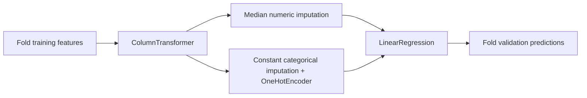
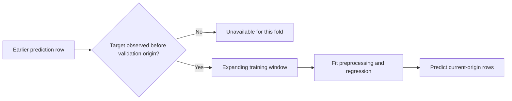

# Body Weight Prediction V1 and Temporal Evaluation

## Problem definition

V1 predicts the same anonymous user's future observed body weight in kilograms.
For a measurement at prediction time `t`, the label is the observed measurement
closest to `t + 7 days` within a 5–9 day window. The earlier timestamp wins an
equal-distance tie. Labels are never interpolated, carried forward, or inferred.

Seven days is a narrow, understandable starting horizon aligned with common
weekly progress review. This experiment does not support arbitrary dates or
multiple horizons.

## Eligibility and features

A row requires five prior valid measurements, so one or two observations never
produce a prediction. Rows are sorted by anonymous user, UTC measurement time,
and stable source order. Invalid measurements, insufficient histories, and absent
future observations are counted separately.

Features known at prediction time are current and previous weight, elapsed days,
days since the prior measurement, latest 3- and 5-observation means, recent
change, recent measurement count, fitness goal, and activity level. Anonymous
user IDs are metadata, not features. Email, names, raw IDs, authentication fields,
future nutrition/workout data, and target-derived statistics are absent.

## Baselines and regression pipeline

Last Value predicts the current measured weight. Recent Trend fits an analytical
least-squares kg/day slope over up to five observations available through `t` and
projects it to the matched target time. It falls back to Last Value with fewer
than two distinct timestamps.

Unknown categories are handled safely. Every preprocessing step is fitted only
inside a temporal training fold. No model is persisted.

## Temporal backtesting and leakage prevention

Evaluation uses expanding UTC prediction origins. All examples sharing an origin
form one validation fold. A training example is usable only when both its
prediction time and observed target time are strictly earlier than the validation
prediction time.

This prevents per-user and cross-user future leakage. Random splitting, centered
rolling windows, full-dataset imputation, and future-filled values are not used.

## Metrics and interpretation

MAE in kilograms is primary. RMSE highlights larger errors. R² is reported only
with at least two non-constant actual values. Every method uses the same rows.
Regression improvement is measured against the lower-MAE baseline.

- At least 5% improvement: incremental value in this evaluation.
- Within ±5%: the baseline remains competitive; complexity is not justified.
- Worse by 5% or more: regression does not justify production use.

These are portfolio interpretation rules, not statistical-significance claims.

## Real versus synthetic results and privacy

The notebook loads pseudonymized read-only PostgreSQL data only when
`DATA_SCIENCE_DATABASE_URL` is configured. Otherwise it runs deterministic,
clearly labeled synthetic pipeline validation. Synthetic metrics are never real
accuracy. Small real datasets produce structured insufficient-data results.

The Markdown report contains aggregate origin, configuration, eligibility,
metrics, exclusions, limitations, and recommendation. It omits user IDs and is
written beneath ignored `artifacts/`.

## Known limitations and production readiness

- Measurement cadence is irregular and targets may be 5–9 rather than 7 days.
- Hydration, clothing, scale variation, and timing add unmodeled noise.
- Sparse users may contribute no evaluation folds.
- A pooled linear relationship may not represent every user equally.
- Synthetic series validate mechanics, not generalization.
- The 5% practical threshold needs product calibration.

Production integration requires representative real histories, stable gains over
both baselines across periods and users, error and subgroup review, interval and
product design, privacy approval, and monitoring. None is bypassed by synthetic
results.

## Next stage

After sufficient real history exists, the next recommended stage is **Body Weight
Model Robustness and Calibration**: repeated temporal cutoffs, error slices by
cadence/history length, prediction intervals, and a regularized linear comparison.
Strength modeling and application integration remain separate later stages.

