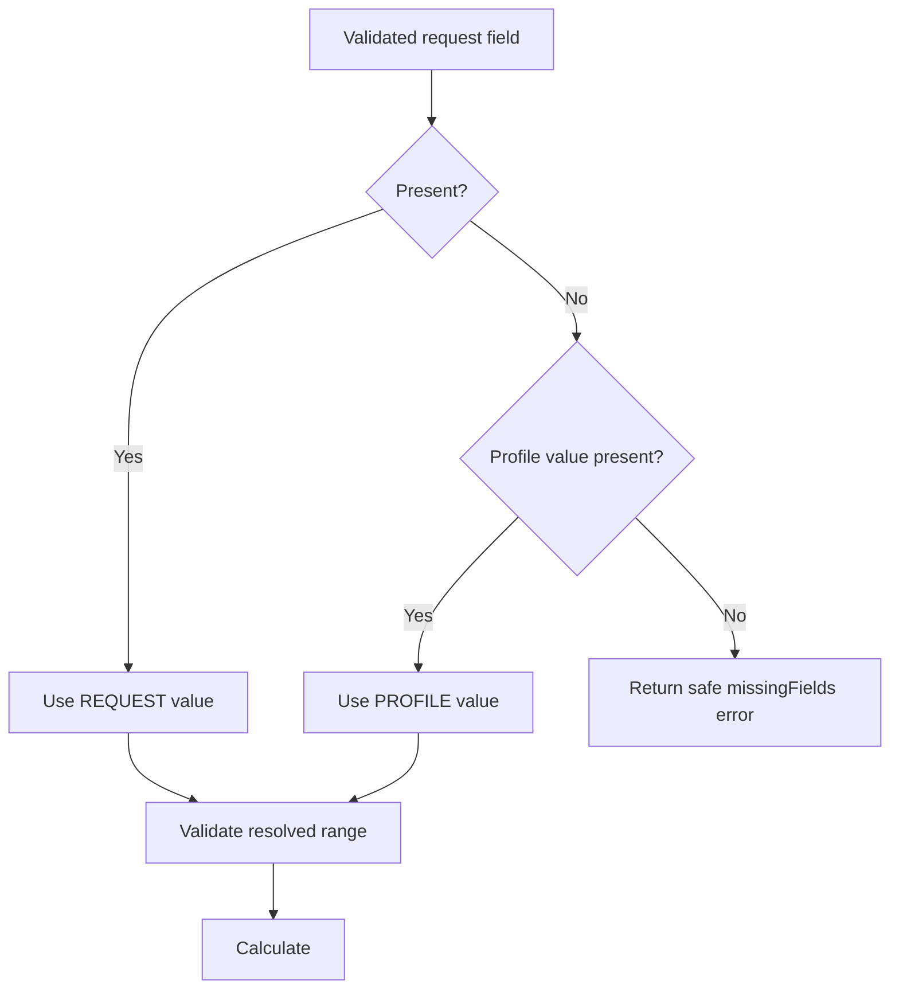
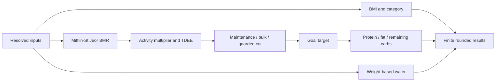
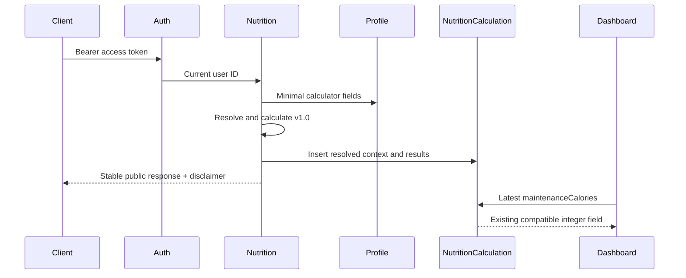

# Calories Calculator backend

## Scope and route map

This authenticated API provides deterministic general-fitness estimates. It does not diagnose conditions, prescribe treatment, or provide medically individualized nutrition advice.

| Method | Route                              | Purpose                                                         |
| ------ | ---------------------------------- | --------------------------------------------------------------- |
| `POST` | `/api/v1/nutrition/calculate`      | Resolve inputs, calculate targets, and save one history record  |
| `GET`  | `/api/v1/nutrition/profile-inputs` | Return only calculator-relevant profile values and completeness |
| `GET`  | `/api/v1/nutrition/latest`         | Return the authenticated user's newest calculation or `null`    |
| `GET`  | `/api/v1/nutrition/history`        | Return bounded, paginated, date-filtered calculation history    |

Every route requires a current authenticated user. The client cannot supply a user ID.

## Input resolution and profile fallback

Each of `age`, `gender`, `heightCm`, `weightKg`, `activityLevel`, and `goal` resolves independently:

1. An explicit validated request value wins.
2. Otherwise the corresponding profile value is used.
3. Otherwise the request fails with `Additional information is required` and safe `missingFields` details.

`birthDate` becomes completed calendar years using UTC year, month, and day components. Millisecond/365 approximations are not used. Request overrides never update `Profile`; profile editing remains a separate concern.

`PREFER_NOT_TO_SAY` remains a valid stored profile preference, but Mifflin–St Jeor requires a sex-specific constant. The calculation therefore asks for an explicit `MALE` or `FEMALE` calculator value and does not alter the stored preference.

## Formula methodology

### BMI

`BMI = weightKg / heightMeters²`, rounded to two decimals.

- below 18.5: `UNDERWEIGHT`
- 18.5 to below 25: `NORMAL`
- 25 to below 30: `OVERWEIGHT`
- 30 or above: `OBESITY`

BMI is a general screening estimate. It does not directly measure body composition, fat distribution, or health status.

### BMR and activity

Version `1.0` uses Mifflin–St Jeor:

- male: `10 × kg + 6.25 × cm - 5 × age + 5`
- female: `10 × kg + 6.25 × cm - 5 × age - 161`

TDEE uses the unrounded BMR multiplied by:

| Activity           | Multiplier |
| ------------------ | ---------: |
| `SEDENTARY`        |        1.2 |
| `LIGHT`            |      1.375 |
| `MODERATE`         |       1.55 |
| `VERY_ACTIVE`      |      1.725 |
| `EXTREMELY_ACTIVE` |        1.9 |

TDEE and displayed BMR are rounded to whole kilocalories. Maintenance equals rounded TDEE. Bulking adds 300 kcal and cutting subtracts 500 kcal.

Cutting uses conservative general-calculator guardrails of 1500 kcal for male inputs and 1200 kcal for female inputs. A clamped result returns and persists `safetyFloorApplied: true`. These floors are transparency guardrails, not prescriptions.

Goal mapping:

- `BUILD_MUSCLE`: bulking target
- `LOSE_FAT`: guarded cutting target
- `IMPROVE_STRENGTH`: maintenance +150 kcal
- `MAINTAIN_WEIGHT`: maintenance
- `GENERAL_FITNESS`: maintenance

### Macronutrients

Protein coefficients are 2.0 g/kg for building muscle and losing fat, 1.8 g/kg for strength, and 1.6 g/kg for maintenance/general fitness. Fat is 0.8 g/kg. Protein and carbohydrates use 4 kcal/g; fat uses 9 kcal/g. Carbohydrates receive the remaining calorie budget.

Targets are whole grams. If future coefficients make protein plus fat exceed the calorie target, both allocations are reduced within the available calorie budget and carbohydrates become zero. `macroFallbackApplied` exposes and persists this behavior. The strategy is deterministic, not medically individualized.

### Water

`waterLiters = weightKg × 0.035`, rounded to two decimals. Climate, exercise duration, pregnancy, medications, and health conditions can materially change hydration needs; workout-specific adjustments are intentionally absent.

## Validation and rounding

- age: integer 14–100
- height: 100–250 cm, up to two decimals
- weight: 30–350 kg, up to two decimals
- enums: existing Gender, ActivityLevel, and FitnessGoal values only
- history: page ≥1, limit 1–100, valid sort order and chronological date range

All outputs are checked for finite numbers. Prisma Decimal values are explicitly converted to JavaScript numbers; Decimal objects never enter public responses.

## Persistence, versioning, and history

Every successful calculation creates one `NutritionCalculation` using the access-token user ID and server time. Version `1.0` persists the exact resolved demographic inputs, classifications, selected goal, recommended calories, formula, and guardrail flags alongside the established output fields.

The `extend_nutrition_calculation_context` migration adds context fields as nullable so pre-existing rows remain readable. Legacy rows return `inputs: null`, `methodology: null`, and null for context-dependent values that cannot be reconstructed. BMI category can be derived exactly from stored BMI.

History uses the existing `(userId, calculatedAt DESC)` index, a count plus one bounded select, and stable ID ordering. There are no relation loops or N+1 queries.

## Dashboard compatibility

The existing `maintenanceCalories` column remains an integer and is populated for every new calculation. The Dashboard continues selecting only the authenticated user's newest `maintenanceCalories` by `calculatedAt`, so no Dashboard code change is required.

## Privacy and security

- Authentication is applied to the complete nutrition router.
- Data is always filtered by the authenticated user ID.
- Requests cannot name another user.
- Profile queries select only birth date, gender, height, weight, activity, and goal.
- History queries use explicit minimal selects.
- Raw Prisma errors, tokens, profile identity, and unrelated fields are never returned.
- Calculation inputs and body measurements are not logged.

The centralized response disclaimer is: “These estimates are for general fitness guidance and are not medical advice.”

## Known limitations and future reuse

- Estimates do not account for body composition, pregnancy, medical conditions, medications, climate, or workout-specific expenditure.
- Mifflin–St Jeor cannot calculate from `PREFER_NOT_TO_SAY` without an explicit calculator override.
- No meal planning, food database, supplements, nutrition diary, or medical workflow exists.
- Existing legacy rows cannot recover demographic context that was never stored.

The future Calories frontend should consume `profile-inputs`, preserve explicit overrides, display sources and guardrail flags, and render the disclaimer. The pure calculator may later be reused by AI Coach only as a deterministic estimate provider; formula ownership and versioning should remain in this module.
