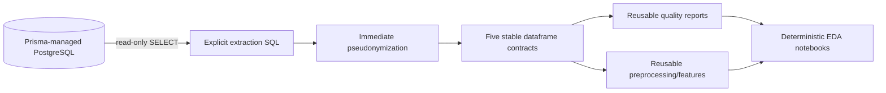
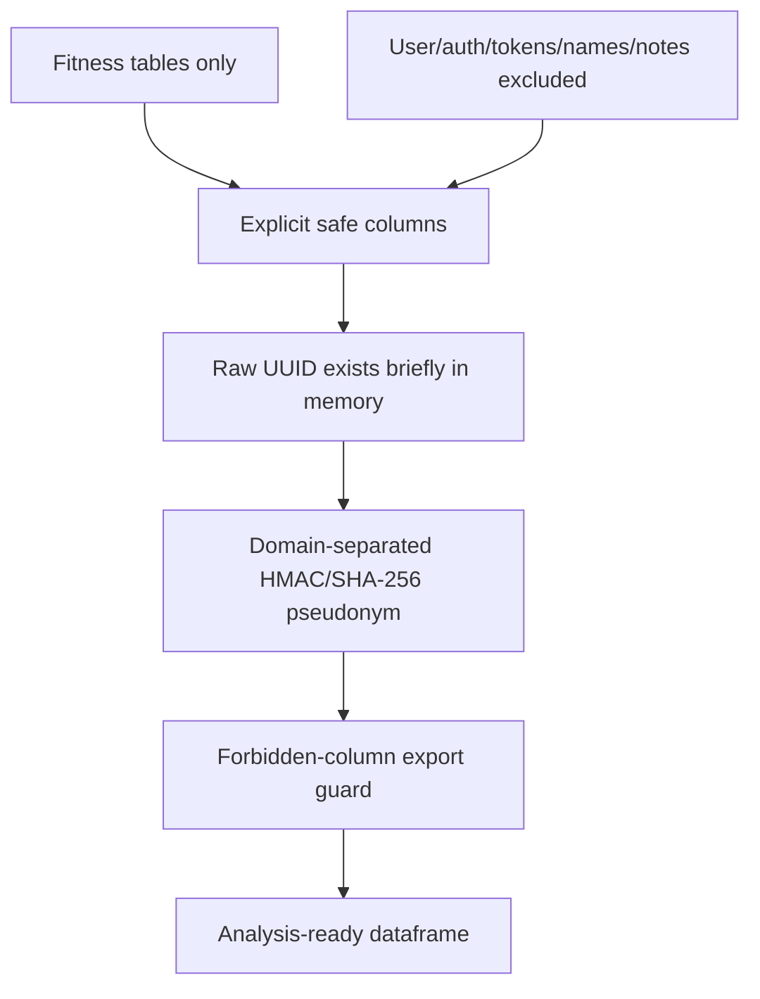
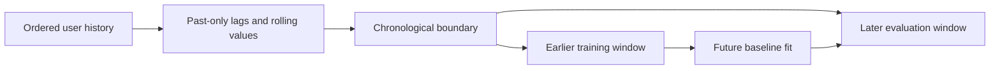

# Python Data Science Foundation and EDA Pipeline

The implementation is maintained in [`data-science/`](../../data-science/README.md).
It is deliberately isolated from the Node/React runtime and Prisma migrations.

## Data flow

## Privacy flow

Pseudonyms permit longitudinal grouping but are not anonymous. Custom-machine
names and all free text are excluded because users can enter identifying content.
No user dataset is committed, and generated data formats are ignored.

## Future training and evaluation

This foundation stops before `model.fit`. It establishes typed contracts,
causal-feature tests, and chronological splitting so the future ML stage has an
auditable leakage boundary. See the workspace README for setup, dataset details,
quality behavior, notebook operation, limitations, and the next recommended stage.

