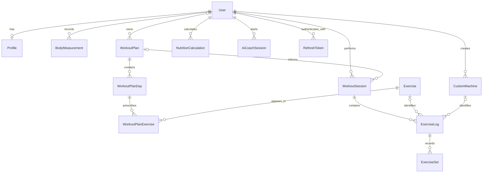

# MetaForm GYM Core Database Design

## Scope

This document describes the initial PostgreSQL schema for MetaForm GYM. It covers identity-ready user records, fitness profiles, body measurements, exercises and user equipment, normalized workout history, workout plans, nutrition calculation history, and rules-based coach sessions. It does not implement authentication, APIs, seed data, analytics aggregates, or machine-learning features.

All primary keys are UUIDs. Domain timestamps use PostgreSQL `timestamptz(3)`, while `Profile.birthDate` uses a date because time-of-day and timezone are not meaningful for a birth date. Measurement and calculated values that require precision use fixed-scale decimals.

## Entity relationship diagram

## Models

### User

Owns user-specific data and provides fields needed by future authentication. `email` is unique, `passwordHash` never stores plaintext, `role` defaults to `USER`, and accounts are active by default. Email normalization and password hashing belong to future application logic.

### Profile

Stores one current fitness profile per user through unique `userId`. Registration initially requires only `fullName`; physical attributes and goals remain nullable until onboarding or profile completion. The relation is optional from the user side so account creation and profile onboarding can occur separately. `currentWeightKg` is a convenient current snapshot; it is not the source for historical analysis.

### RefreshToken

Stores revocable refresh-token sessions. Only a SHA-256 token hash is persisted; the raw JWT is sent exclusively through an HttpOnly cookie. Multiple rows allow concurrent devices and sessions. User/revocation/expiration indexes support rotation, logout, and future expired-session cleanup. Deleting a user cascades to all sessions.

### BodyMeasurement

Stores timestamped body measurements. The `(userId, measuredAt DESC)` index supports weight and body-composition timelines, recent-value lookup, and weekly or monthly trend queries.

### Exercise

Represents the shared exercise library. `slug` is globally unique. Primary and secondary muscles use the same `MuscleGroup` enum. Secondary muscles are stored as a PostgreSQL enum array because the vocabulary is finite and no relationship metadata is needed. Prisma can query the array with `has`, `hasSome`, and `hasEvery`; a GIN index supports containment queries.

Instructions and common mistakes are ordered text arrays. Recommended reps are text so prescriptions can express ranges such as `8-12`, while actual performed reps remain integers in `ExerciseSet`.

### CustomMachine

Represents user-defined equipment and is unique by user and name. The user-and-target-muscle index supports filtering a user's equipment library.

### WorkoutSession

Represents an actual workout occurrence. Its optional plan link is informational and becomes null if the plan is deleted, preserving completed history. User-and-time indexes support recent sessions and time-bucket analytics.

### ExerciseLog

Represents one ordered exercise or custom-machine movement within a session. `(workoutSessionId, orderIndex)` is unique. Indexes on both optional source keys support exercise-frequency and history joins.

Exactly one of `exerciseId` and `customMachineId` must be present. Prisma does not model this XOR check declaratively, so it must be enforced by future application validation and tested at repository boundaries. Source deletion uses PostgreSQL `NO ACTION` to avoid silently removing historical meaning.

### ExerciseSet

Stores every performed set separately. Weight, repetitions, duration, and distance are nullable to support strength, timed, and distance-based movements. The unique `(exerciseLogId, setNumber)` constraint preserves set order. Raw sets support volume (`weight × reps`), progression, PR detection, average weight, session history, regression inputs, and plateau analysis without storing derived aggregates.

Future validation should require at least one meaningful performance value among weight, reps, duration, or distance and should reject negative values.

### WorkoutPlan

Represents either a user-owned plan or a system plan when `userId` is null. Public and template flags are indexed together for library discovery. Deleting an owner removes their personal plans, while linked workout sessions retain history through `SetNull`.

### WorkoutPlanDay

Defines one ordered day per weekday within a plan. Both weekday and order are unique within the parent plan. Rest days are represented explicitly rather than inferred from an empty exercise list.

### WorkoutPlanExercise

Defines an ordered exercise prescription for a plan day. Sets and rest use integers; reps use text to support ranges and nonstandard prescriptions. Deleting a plan or day cascades to prescriptions, while an exercise referenced by a prescription cannot be deleted.

### NutritionCalculation

Stores point-in-time calculation results because historical recommendations may need to be explained or compared later. Whole calorie targets use integers; BMI, BMR, TDEE, macros, and water use fixed-scale decimals. `(userId, calculatedAt DESC)` supports calculation history.

### AiCoachSession

Uses the established project terminology while remaining compatible with an initial rules-based implementation. Answers and optional recommendations are JSON because questionnaire structures can evolve. User/time and user/status indexes support history and resuming in-progress sessions.

## Delete behavior

- Deleting a user cascades to their profile, measurements, custom machines, workout sessions, personal workout plans, nutrition calculations, coach sessions, and refresh-token sessions.
- Deleting a workout session cascades to its exercise logs and sets.
- Deleting a workout plan cascades to its days and prescribed exercises. Historical sessions retain a null plan reference.
- Shared exercises and custom machines referenced by workout history use `NO ACTION`; they must not be deleted while referenced.
- Shared exercises referenced by workout plans also use `NO ACTION`.
- User-deletion workflows should be integration-tested because they traverse multiple related aggregates in one transaction.

## Index strategy and analytics support

- Body trends: `BodyMeasurement(userId, measuredAt DESC)`.
- Session frequency and weekly/monthly history: `WorkoutSession(userId, startedAt DESC)` and completed-time index.
- Exercise frequency: source indexes on `ExerciseLog`, joined through indexed session ownership and time.
- Volume, strength progression, averages, and PRs: normalized `ExerciseSet` rows joined through `ExerciseLog` and `WorkoutSession`.
- Exercise discovery: published primary-muscle and equipment indexes plus a GIN secondary-muscle index.
- Plan discovery: `WorkoutPlan(isPublic, isTemplate)`.
- Nutrition history: `NutritionCalculation(userId, calculatedAt DESC)`.
- Coach history: user/time and user/status indexes.

Derived weekly totals, monthly totals, estimated one-rep max, trend slopes, and plateau flags are intentionally not persisted. They can be computed from raw facts and later promoted to views, materialized views, or dedicated analytics storage only after real query and performance evidence exists.

## Application-level invariants

Prisma cannot express all useful cross-field checks in the schema. Future validation must enforce:

- An `ExerciseLog` references exactly one of `Exercise` or `CustomMachine`.
- A rest day has no prescribed exercises.
- Completed times are not earlier than started times.
- Set numbers, ordering indexes, counts, repetitions, duration, rest, and distance are non-negative, with set numbers normally starting at one.
- Percentages and physical measurements remain within plausible positive ranges.
- Each exercise set contains an appropriate performance metric for its movement type.
- Coach-session status and `completedAt` remain consistent.
- System plans (`userId = null`) are created only by trusted administrative logic.
- Email and slug values are normalized before persistence.

Database-level check constraints may be added later through carefully maintained SQL migrations if these invariants need protection from writes outside the application.

## Intentionally postponed

- Authentication and authorization logic
- Case-insensitive email support
- Exercise seed data
- API controllers, routes, services, and repositories for these models
- Object storage and image upload infrastructure
- Analytics aggregates, views, caching, and reporting tables
- AI or machine-learning implementation
- Soft deletion and audit-event history
- Database check constraints not directly represented by Prisma
