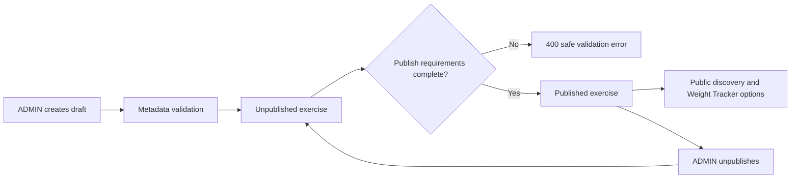
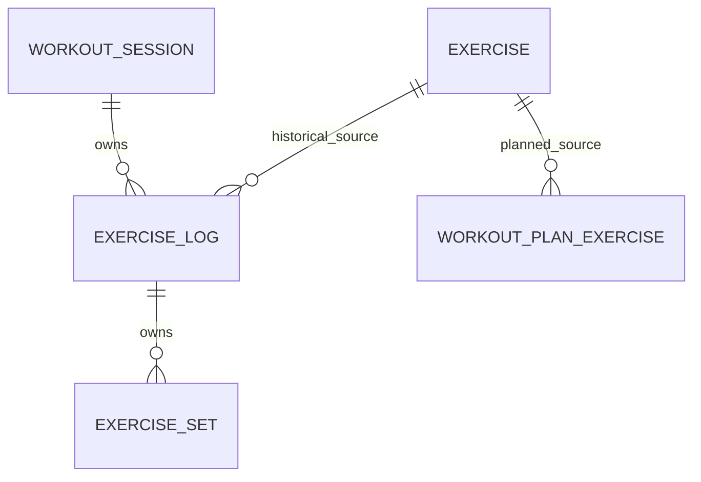
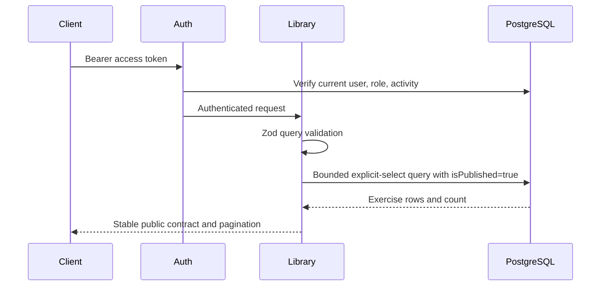
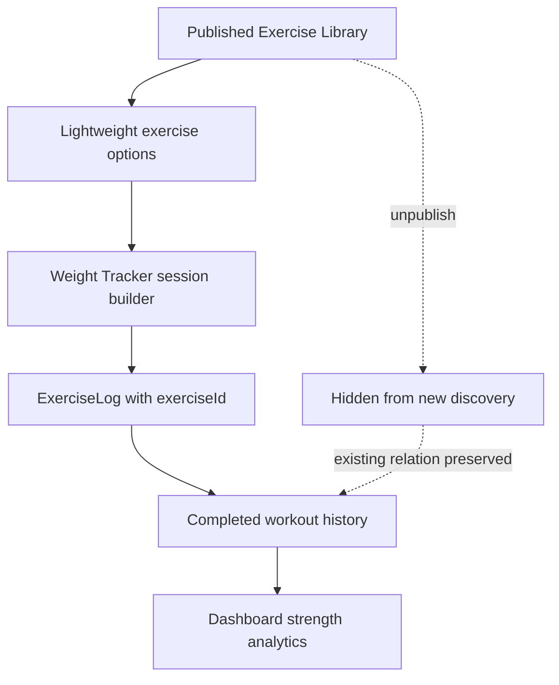

# Exercise Library backend

## Route map

All routes require a valid access token. Admin routes additionally require the current database user to have the `ADMIN` role.

### Public library

| Method | Route                              | Purpose                                                  |
| ------ | ---------------------------------- | -------------------------------------------------------- |
| `GET`  | `/api/v1/exercises`                | Published exercise discovery with pagination and filters |
| `GET`  | `/api/v1/exercises/:exerciseId`    | Published detail by UUID                                 |
| `GET`  | `/api/v1/exercises/slug/:slug`     | Published detail by normalized slug                      |
| `GET`  | `/api/v1/exercises/filter-options` | Stable enum and subgroup filter configuration            |
| `GET`  | `/api/v1/exercises/options`        | Bounded lightweight Weight Tracker/autocomplete options  |

### Administration

| Method   | Route                                           | Purpose                                 |
| -------- | ----------------------------------------------- | --------------------------------------- |
| `POST`   | `/api/v1/admin/exercises`                       | Create draft or complete metadata       |
| `GET`    | `/api/v1/admin/exercises`                       | List published and unpublished metadata |
| `GET`    | `/api/v1/admin/exercises/:exerciseId`           | Admin detail                            |
| `PATCH`  | `/api/v1/admin/exercises/:exerciseId`           | Partial metadata update                 |
| `POST`   | `/api/v1/admin/exercises/:exerciseId/publish`   | Validate and publish                    |
| `POST`   | `/api/v1/admin/exercises/:exerciseId/unpublish` | Remove from public discovery            |
| `DELETE` | `/api/v1/admin/exercises/:exerciseId`           | Delete only when unreferenced           |

## Public contracts

Public list responses use the established `{ success, data: { items, pagination } }` envelope. Items contain identity, classification, media URLs, description, and recommendation fields, but omit `instructions` and `commonMistakes`. Detail responses use `data.exercise` and include those instructional arrays plus ISO `createdAt` and `updatedAt` timestamps.

Only `isPublished = true` rows are eligible. Unpublished and nonexistent UUID/slug lookups return the same safe `404 Resource not found` response.

The options response is intentionally smaller:

```json
{
  "success": true,
  "data": {
    "items": [
      {
        "id": "uuid",
        "name": "Incline Barbell Bench Press",
        "primaryMuscle": "CHEST",
        "muscleSubgroup": "UPPER_CHEST",
        "equipmentType": "BARBELL",
        "thumbnailUrl": null
      }
    ]
  }
}
```

It supports `search`, `primaryMuscle`, `muscleSubgroup`, and a maximum `limit` of 50. Instructions, mistakes, descriptions, video URLs, and relation data are not queried or returned.

## Filtering, searching, sorting, and pagination

`GET /exercises` and the admin list support case-insensitive search across name and description plus exact filters for primary muscle, subgroup, equipment, difficulty, and movement type. `secondaryMuscle` uses PostgreSQL enum-array containment and the existing GIN index. Filters compose with `AND` semantics.

Public default sorting is name ascending; admin default sorting is updated time descending. Supported sort fields are `name`, `createdAt`, and `updatedAt`. UUID ascending is always appended as a stable tie-breaker.

Pagination starts at page 1, defaults to 20, and is capped at 100. Responses include `totalItems`, `totalPages`, `hasNextPage`, and `hasPreviousPage`. Count and page queries execute together without unbounded reads.

## Muscle subgroup model

`Exercise.muscleSubgroup` is a nullable `MuscleSubgroup` enum. It is nullable only for backward compatibility with rows created before this migration. New admin creates require a subgroup, and publication requires a subgroup compatible with the primary muscle.

The single typed `MUSCLE_SUBGROUPS_BY_PRIMARY` mapping owns compatibility and the filter-options response. It covers:

- chest: upper, middle, lower, all chest;
- back: lats, upper back, middle back, traps, all back;
- shoulders: front, side, rear delts, all shoulders;
- biceps: long head, short head, brachialis, all biceps;
- triceps: long, lateral, medial heads, all triceps;
- legs: quadriceps, hamstrings, calves, adductors, all legs;
- core: upper abs, lower abs, obliques, deep core, all core;
- glutes: maximus, medius, minimus, all glutes;
- lower back: erector spinae and all lower back;
- full body: all full body.

Secondary muscles must be unique and cannot repeat the primary muscle.

## Slug strategy

Slugs are normalized to lowercase ASCII, replace unsafe/non-alphanumeric runs with one hyphen, trim surrounding hyphens, and validate at 2–150 characters. Omitted slugs are deterministically generated from the exercise name. A collision returns HTTP 409 and requires the administrator to select a clearer slug; random or time-based suffixes are never generated.

Slug lookup normalizes its path value using the same function.

## Admin publish lifecycle

Metadata patches cannot directly change `isPublished`; explicit lifecycle endpoints make publication auditable and hard to trigger accidentally. Publication requires:

- nonblank name;
- primary muscle and compatible subgroup;
- equipment, difficulty, and movement classification;
- at least one nonblank instruction.

Video is not required. `videoUrl: null` is a valid published state so a future frontend can display “video unavailable.” Publishing and unpublishing are idempotent.



## Deletion and historical references

Deletion runs in a transaction, checks `ExerciseLog` and `WorkoutPlanExercise`, and returns 409 when either relation exists. PostgreSQL `NO ACTION` foreign keys remain the final concurrent-race safeguard. The response recommends unpublishing instead. There is no cascade from Exercise into workout history or plans.

Unpublishing changes only `isPublished`. Existing sessions, sets, PR calculations, history, and dashboard strength analytics continue to resolve the exercise relation. New Weight Tracker logs and bulk sessions require a currently published global exercise.



## Public discovery flow



## Weight Tracker integration

The Weight Tracker can consume `/api/v1/exercises/options` for autocomplete and submit the selected UUID as `exerciseId`. It does not need to duplicate Exercise Library filtering or large content fields.



## Authentication, authorization, and errors

Authentication revalidates the user in PostgreSQL on every request, so deleted or inactive users and stale token roles cannot bypass current account state. One role middleware protects the entire admin router; client-provided roles are ignored.

Zod rejects unknown fields, invalid UUIDs, enum filters, malformed booleans, incompatible classifications, duplicate secondary muscles, oversized text, and non-HTTP(S) media URLs. Expected failures use safe `AppError` messages. Prisma codes, SQL, stack traces, paths, tokens, and user data are not exposed.

## URL-only media behavior

`videoUrl` and `thumbnailUrl` accept only optional HTTP/HTTPS strings up to 2,048 characters. Blank strings normalize to null. The API does not fetch the URL, trust a MIME type, upload bytes, inspect media, or hold storage credentials.

A future S3/CloudFront workflow can upload through a separate media service and store the resulting CloudFront URL in these unchanged fields. Object authorization, lifecycle, transcoding, and deletion must remain outside this metadata module.

## Query and index strategy

Queries use explicit selects, one count plus one bounded page query, and no relation loops, so there is no N+1 pattern. Relevant indexes are:

- unique `slug` for normalized lookup and collision enforcement;
- `(isPublished, name)` for the default public listing;
- `(primaryMuscle, isPublished)` for primary classification;
- `(muscleSubgroup, isPublished)` for subgroup discovery;
- `(equipmentType, isPublished)` for equipment filtering;
- GIN `secondaryMuscles` for enum-array containment;
- existing `ExerciseLog.exerciseId` and `WorkoutPlanExercise.exerciseId` for deletion checks and history.

Difficulty and movement enums have low cardinality and are evaluated within already narrowed, bounded queries; no speculative standalone indexes were added.

## Known limitations and extension guidelines

- No media upload, media inspection, transcoding, S3, or CloudFront integration exists.
- No exercise content is seeded by this feature.
- Search uses PostgreSQL case-insensitive containment, not ranking or typo tolerance.
- Legacy exercises may have `muscleSubgroup: null` until an administrator classifies them.
- Administration currently has API contracts only; no admin frontend exists.

Keep filter definitions and subgroup compatibility centralized. Add new enum values through an additive migration and update the one compatibility map plus shared contract. Keep list and option selects lightweight, preserve explicit publish endpoints, and never relax historical foreign keys to cascades.
