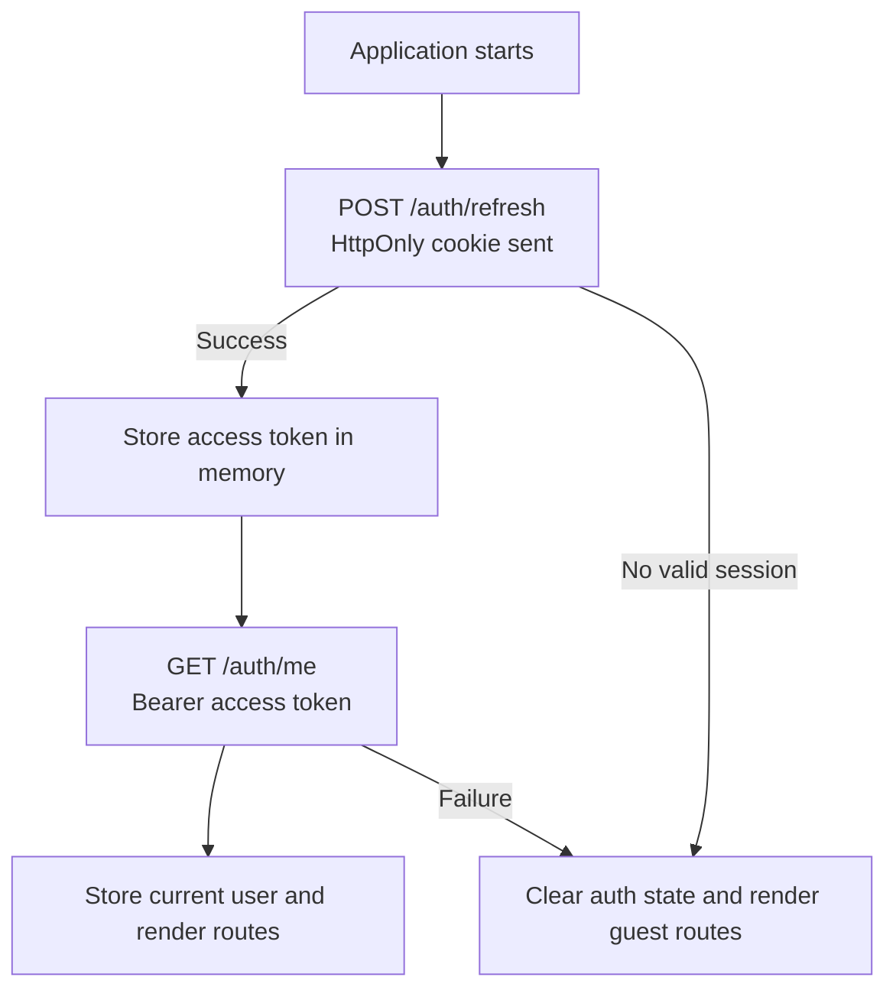

# Frontend authentication

## Architecture

The frontend authentication boundary consists of four small layers:

- `services/api-client.ts` owns Axios configuration, Bearer-token attachment, and coordinated token refresh.
- `services/auth.service.ts` owns endpoint calls, response parsing, and conversion of transport failures into safe user-facing errors.
- `store/auth.store.ts` owns the current user, the in-memory access token, and authentication lifecycle actions.
- route guards and `AuthInitializer` control access without flashing protected content.

API response bodies are parsed with Zod before they enter application state. Form input is validated with React Hook Form and Zod using rules that match the backend.

## Token strategy

The access token exists only in the Zustand store for the current page lifetime. The store does not use persistence middleware, and no token is written to `localStorage`, `sessionStorage`, IndexedDB, or a JavaScript-readable cookie.

The backend owns the refresh token in an HttpOnly cookie scoped to `/api/v1/auth`. Axios sends that cookie because `withCredentials` is enabled. Frontend JavaScript cannot read it.



## Axios refresh queue

Protected requests receive the current access token through a request interceptor. When a protected request returns `401`, its response interceptor joins one shared refresh promise. Concurrent failures therefore create one refresh request, then retry each original request once with the new access token.

Login, registration, refresh, and logout are excluded from automatic retry. A request without an attached Bearer token is also excluded. These rules, plus a per-request retry flag, prevent refresh loops. Failed refresh clears client authentication and moves the browser to `/login`.

## Initialization and routing

`AuthInitializer` attempts refresh exactly once for an application load. While it is pending, the application displays a full-page accessible loading state. After refresh succeeds, it requests `/auth/me` and stores the validated user.

- `/login` and `/register` are guest-only routes.
- `/app` is protected and currently contains only the agreed authentication placeholder.
- `/` redirects according to authentication state.
- Unknown URLs render a minimal not-found page with a safe navigation option.

## Environment configuration

Copy `apps/web/.env.example` to `apps/web/.env.local` for local development:

```env
VITE_API_URL=http://localhost:3000/api/v1
```

Frontend environment variables contain no JWT secrets. The API must allow the frontend origin and credentials through its CORS configuration.

## Local commands

From the repository root:

```powershell
npm.cmd install
npm.cmd run dev:api
npm.cmd run dev:web
```

Verification commands:

```powershell
npm.cmd run typecheck --workspace @metaform/web
npm.cmd run lint
npm.cmd run format:check
npm.cmd test --workspace @metaform/web
npm.cmd run build --workspace @metaform/web
```

Tests run in JSDOM and mock the authentication service. They never connect to PostgreSQL or the real backend.

## Known limitations and postponed work

This stage intentionally omits password recovery, email verification, OAuth, two-factor authentication, session-management UI, role-management UI, and the real application dashboard. Because access tokens are memory-only, every full browser reload performs refresh rotation before loading the current user; this is intentional.
