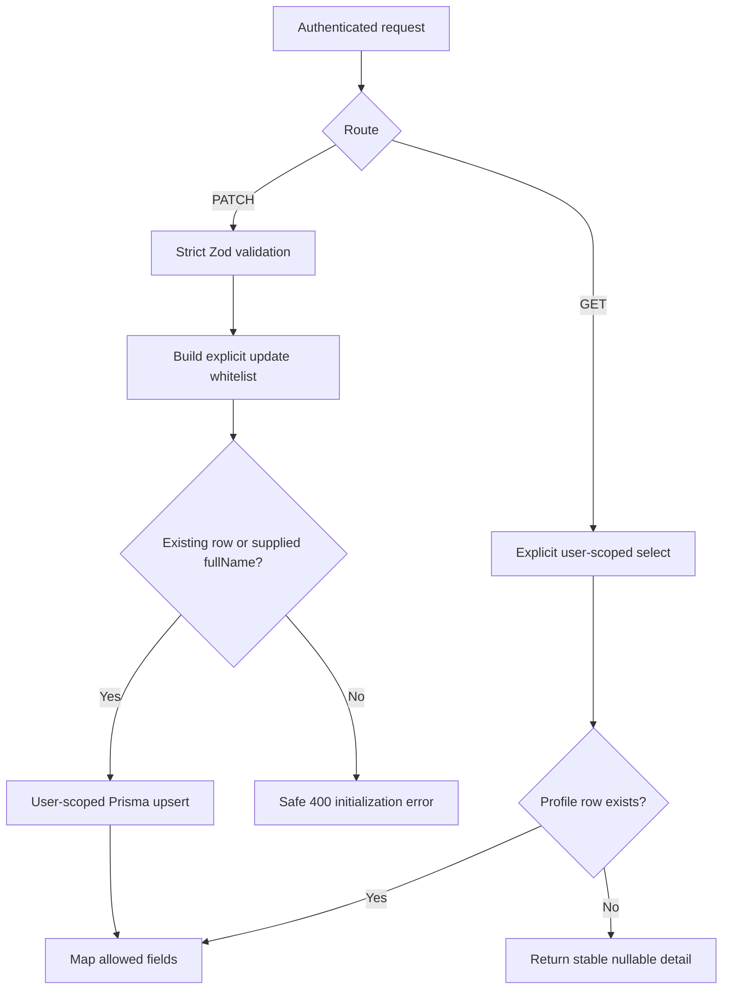
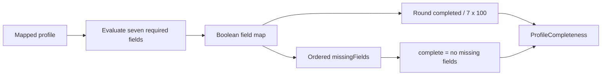
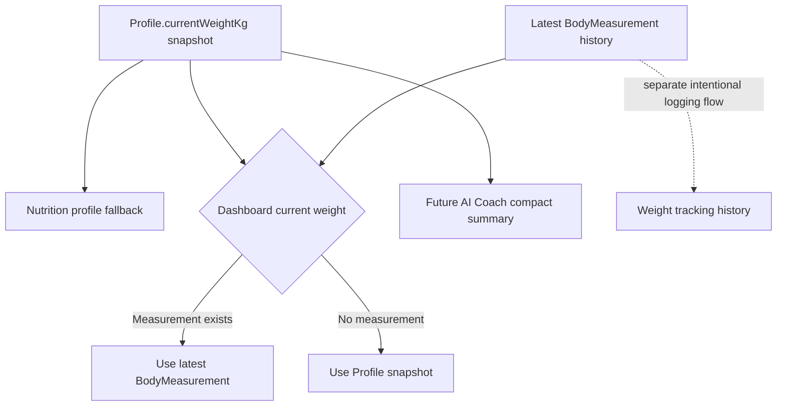

# Profile Backend API

## Scope and schema

The protected Profile API is mounted at `/api/v1/profile`. It reads and updates
only the authenticated user's fitness profile. It does not provide public,
administrative, avatar-upload, or frontend behavior.

The existing Prisma `Profile` model has these domain fields:

| Field              | Database nullability | API editable | Notes                                     |
| ------------------ | -------------------- | ------------ | ----------------------------------------- |
| `fullName`         | Required             | Yes          | Trimmed, 2–100 characters                 |
| `profileImageUrl`  | Nullable             | No           | Reserved for a future managed avatar flow |
| `gender`           | Nullable             | Yes          | Existing `Gender` enum                    |
| `heightCm`         | Nullable             | Yes          | 100–250 cm                                |
| `currentWeightKg`  | Nullable             | Yes          | 30–350 kg snapshot                        |
| `birthDate`        | Nullable             | Yes          | ISO date-only; calculated age 14–100      |
| `fitnessGoal`      | Nullable             | Yes          | Existing `FitnessGoal` enum               |
| `activityLevel`    | Nullable             | Yes          | Existing `ActivityLevel` enum             |
| IDs and timestamps | Required             | No           | Server-controlled and not returned        |

The model does not contain separate first/last names, experience level,
preferred workout days, workout duration, injuries, or bio. No schema migration
was needed.

## Routes

| Method  | Route                          | Purpose                          |
| ------- | ------------------------------ | -------------------------------- |
| `GET`   | `/api/v1/profile`              | Editable profile detail          |
| `PATCH` | `/api/v1/profile`              | Strict partial update            |
| `GET`   | `/api/v1/profile/completeness` | Canonical completeness result    |
| `GET`   | `/api/v1/profile/summary`      | Compact reusable fitness context |

Every route requires a valid access token. User identity comes exclusively from
the authenticated request context.

## Read and update flow

### Initialization

`Profile.fullName` is required while the User-to-Profile relation is optional.
Creating a fake or blank name would silently corrupt profile meaning. Therefore,
GET, completeness, and summary return stable null-based contracts for a missing
row without persisting invented data. A PATCH containing a valid `fullName`
initializes the row with `upsert`; later partial PATCH requests need not repeat
the name. The unique `userId` constraint makes repeated/concurrent creation safe.

## PATCH semantics

- Omitted fields remain unchanged.
- `null` clears only nullable fields: birth date, gender, height, current weight,
  activity level, and fitness goal.
- `fullName` is required, trimmed, and cannot be null or blank.
- Unknown fields, empty bodies, and mass-assignment attempts are rejected.
- Measurements support at most two decimal places.
- There are currently no editable optional text fields, so empty-to-null text
  normalization does not apply. Future nullable text fields should implement it
  explicitly in validation rather than as a broad body transform.

Birth dates use strict `YYYY-MM-DD` calendar parsing. The API stores the UTC date
and returns the same date-only format. Age is derived using UTC year/month/day
components, never elapsed milliseconds, and is not persisted.

## Completeness

The stable required fields are `fullName`, `birthDate`, `gender`, `heightCm`,
`currentWeightKg`, `activityLevel`, and `fitnessGoal`. A whitespace-only stored
name is missing. Optional avatar data and server metadata never affect the score.

## Summary and display name

The compact summary contains `displayName`, derived UTC age, gender, height,
current-weight snapshot, activity level, fitness goal, and compact completeness.
`displayName` is the normalized `fullName`, or null. Email is deliberately not
used as a fallback because it is authentication data and the User model has no
other display metadata.

## Weight, Nutrition, and Dashboard semantics

Updating `currentWeightKg` follows **Strategy A**: only the Profile snapshot is
updated. No `BodyMeasurement` is created. Historical measurement logging remains
an explicit, separate action, preventing hidden or duplicate history. Nutrition
continues to read the snapshot. Dashboard continues to prefer the latest
`BodyMeasurement`, falling back to the Profile snapshot only when no measurement
exists.

## Security and privacy

Database reads use explicit selects and every query is scoped to the access-token
user ID. Request bodies cannot supply identity. Responses omit email, password
hashes, roles, tokens, IDs, timestamps, and other authentication metadata. The
service does not log profile bodies, and unexpected persistence errors use the
central generic error response.

## Frontend and future extension guidelines

- The future bilingual Profile UI should consume shared contracts and use the
  completeness endpoint rather than reproducing its field list or percentage.
- Send date-only birth dates and omit unchanged fields. Send null only for an
  intentional clear.
- A missing row has `initialized: false`; the first update must include a name.
- Future avatar support should add a controlled media workflow rather than make
  `profileImageUrl` freely assignable.
- Future AI Coach features may consume `/summary`, but should request new context
  only when justified and must not expose the full Profile database model.
- If new core fields are added, update the Prisma migration, shared contracts,
  mapper, whitelist, completeness policy, tests, and this document together.

## Known limitations

- The schema supports one full name rather than localized or structured names.
- There is no avatar management endpoint.
- Profile snapshot updates do not create historical body measurements by design.
- Completeness reflects the current seven-field fitness onboarding policy; policy
  changes require an intentional API version-compatible review.
