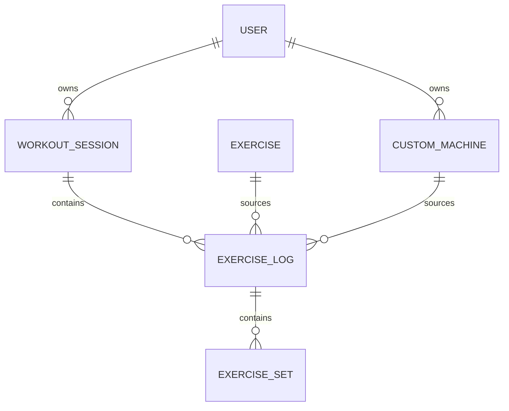
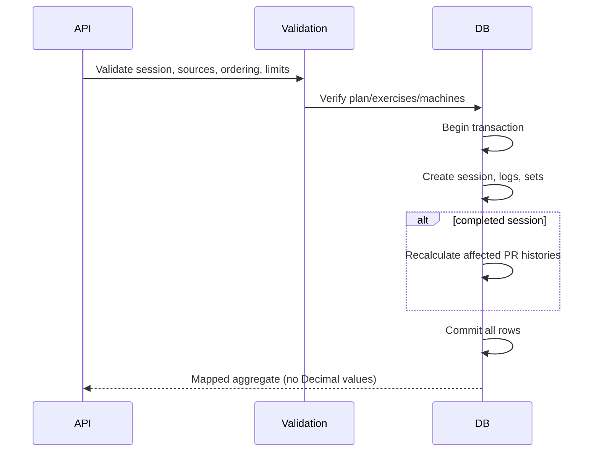
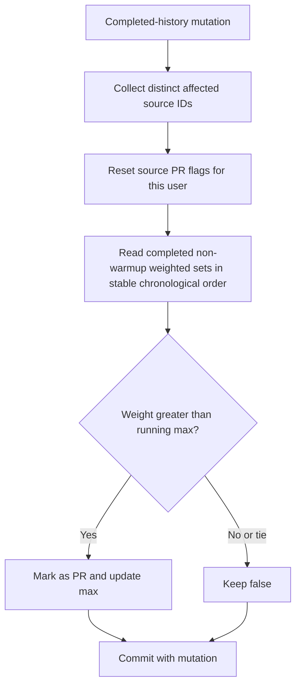

# Weight Tracker backend API

All routes are mounted below `/api/v1/weight-tracker` and require `Authorization: Bearer <access-token>`. Success responses use `{ "success": true, "data": ... }`; validation failures are safe HTTP 400 responses, ownership-safe misses are HTTP 404, and conflicts are HTTP 409. Delete operations return 204 without a body.

## Route map

| Method               | Route                                    | Purpose                                            |
| -------------------- | ---------------------------------------- | -------------------------------------------------- |
| POST / GET           | `/machines`                              | Create or paginate machines                        |
| GET / PATCH / DELETE | `/machines/:machineId`                   | Read, update, or delete one owned machine          |
| POST / GET           | `/sessions`                              | Create or paginate sessions                        |
| POST                 | `/sessions/with-entries`                 | Atomically create a session, logs, and sets        |
| GET / PATCH / DELETE | `/sessions/:sessionId`                   | Read, update, or delete one aggregate              |
| POST                 | `/sessions/:sessionId/complete`          | Complete a session and finalize PRs                |
| POST                 | `/sessions/:sessionId/logs`              | Add an exercise or machine log                     |
| POST                 | `/sessions/:sessionId/logs/reorder`      | Replace the complete log ordering                  |
| PATCH / DELETE       | `/logs/:logId`                           | Update metadata/order or delete a log aggregate    |
| POST                 | `/logs/:logId/sets`                      | Add a set                                          |
| POST                 | `/logs/:logId/sets/reorder`              | Replace the complete set ordering                  |
| PATCH / DELETE       | `/sets/:setId`                           | Update or delete a set                             |
| GET                  | `/sources/:sourceType/:sourceId/history` | Paginated `exercise` or `machine` strength history |

Request bodies are the strict JSON contracts in the feature specification. Unknown fields, client-controlled `userId`, and client-controlled `isPersonalRecord` are rejected. Patch bodies must contain at least one allowed field. Log sources are immutable after creation. `imageUrl` is an optional absolute URL string; multipart data, buffers, local storage, and S3 are not accepted.

## Aggregate and ownership

Machines and sessions are filtered directly by the authenticated user. Logs and sets are authorized through their session. Global exercises can be selected by any authenticated user, while custom machines must be owned. A workout plan must be public, system-owned (`userId` is null), or owned by the caller. Missing and cross-user resources intentionally return the same `Resource not found` response.

A machine with any historical log reference cannot be deleted. Deleting a session is explicitly destructive and relies on the existing database cascades from session to logs to sets. Deleting a log cascades its sets. Live dashboard queries automatically reflect all deletions.

## Transactions

Quick creation, completion, collision-safe reorder, completed-history edits, and deletes requiring PR repair are transactional. Reorder requests must contain every child exactly once with unique non-negative log positions or positive set numbers. Rows are first moved to temporary negative positions, then assigned their final values, avoiding temporary unique-constraint collisions.

Blank sessions are intentionally supported by both ordinary and quick creation (`entries: []`). Bulk requests allow at most 50 logs and 100 sets per log; the application also applies a 32 KB JSON body limit.

## Pagination, filtering, and empty states

Pages start at 1, default to 20 items, and are capped at 100. Responses include `page`, `limit`, `totalItems`, `totalPages`, `hasNextPage`, and `hasPreviousPage`. Empty lists use `items: []`, `totalItems: 0`, and `totalPages: 0`.

Machines support case-insensitive name search, `targetMuscle`, and `createdAt`, `updatedAt`, or `name` sorting. Sessions support completed/incomplete state, inclusive `dateFrom`/`dateTo` filters on `startedAt`, notes search, and `startedAt`/`completedAt` sorting. History supports the same date boundary, pagination, and completion-order sorting. All sort orders include an ID tie-breaker.

## Calculations and precision

- Strength history includes completed sessions only.
- The representative value is the maximum non-warmup `weightKg` for one source in one completed session. This is the dashboard definition.
- Chart points are independently limited to the latest 30 qualifying sessions.
- Personal record is the maximum representative weight. Average is the arithmetic mean of representative session values.
- Latest and previous follow `completedAt` and session ID ordering. Best improvement is the largest positive consecutive representative-weight increase, or zero if no positive increase exists.
- Session volume is the sum of `weightKg × reps` for non-warmup sets where both values exist. Duration-only and distance-only sets contribute zero.
- Durations are whole minutes (floored). Weights, distances, averages, improvements, and volumes are finite JSON numbers rounded to two decimals. Prisma Decimal objects are never returned.

## PR consistency

`isPersonalRecord` is derived, never accepted from clients. Incomplete sessions always store false. On completion, and after a mutation affecting completed history, one PR service resets and replays each affected source chronologically by completion time, session ID, log order, set number, and set ID. A qualifying non-warmup weighted set is marked only when it is strictly greater than the running maximum. The first occurrence of a weight may establish a record; later ties do not.

## Indexes and query behavior

The existing schema indexes are sufficient: `(userId, startedAt)` and `(userId, completedAt)` support session/date access; `(userId, targetMuscle)` and `(userId, name)` support machine ownership/filtering and uniqueness; source foreign-key indexes support history/PR lookup; unique `(workoutSessionId, orderIndex)` and `(exerciseLogId, setNumber)` indexes support ordered children. Case-insensitive substring search is not helped by a normal B-tree; a trigram index was not added for the expected small per-user machine collection. No migration is required.

List and detail queries load bounded aggregates rather than issuing a query per item. History page and chart results are independently bounded; all-history statistics are reduced inside PostgreSQL to one row. SQL is parameterized through Prisma tagged templates, never unsafe string SQL.

## Security and dashboard compatibility

No endpoint returns password hashes, tokens, private authentication metadata, or raw Prisma errors. Notes are not logged. Zod validates UUIDs, ISO timestamps, chronology, enums, decimals, integer bounds, ordering uniqueness, metric presence, and nesting limits.

The dashboard consumes the same underlying completed sessions, source IDs, non-warmup sets, and maximum-per-session representative rule. Completing a session makes eligible strength data visible; editing or deleting completed data changes it immediately. Exercise and machine IDs remain distinct even when their names match.

## Known limitations and next integration

PR replay is intentionally source-scoped but rewrites the affected source’s flags; very long lifetime histories may later benefit from a background repair job or summary table. History is strength-oriented, so completed source sessions without a non-warmup weight do not create representative points. Reorder endpoints replace the complete child ordering rather than accepting a partial subset.

Future image upload work should accept a multipart upload in a separate endpoint, validate content and size, store the object in S3, and then persist only the resulting URL. The current API should remain the metadata contract and must never accept raw buffers in JSON.
