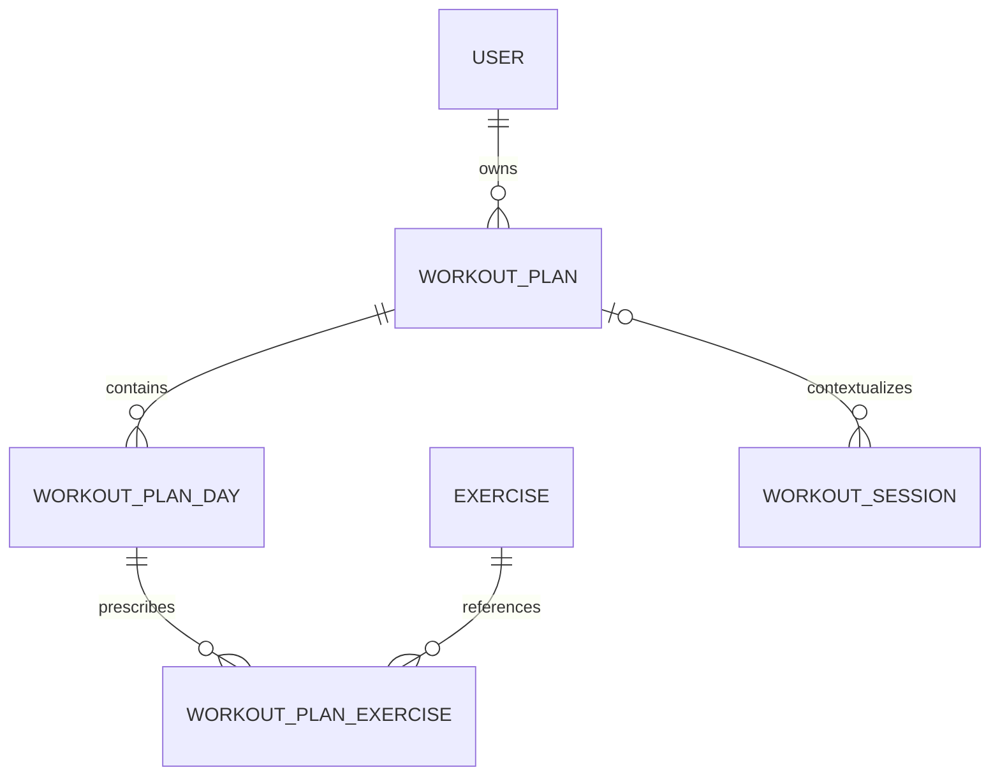
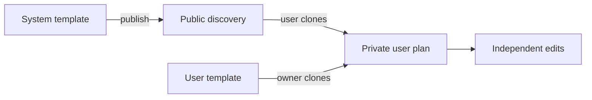
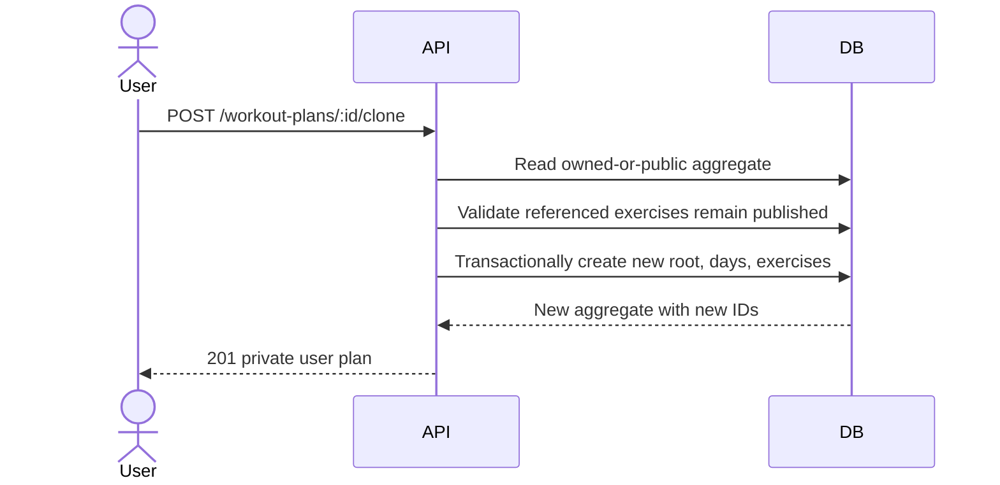
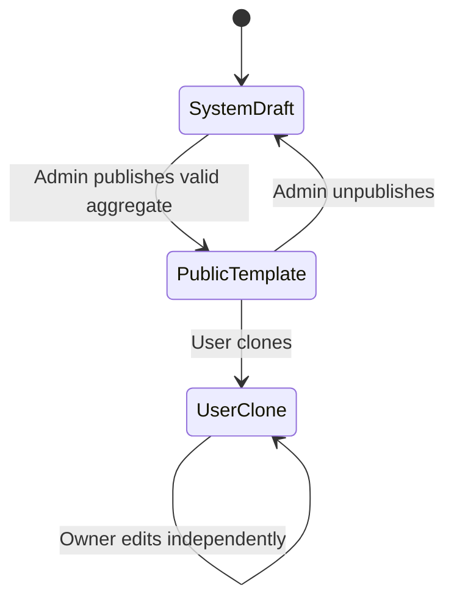
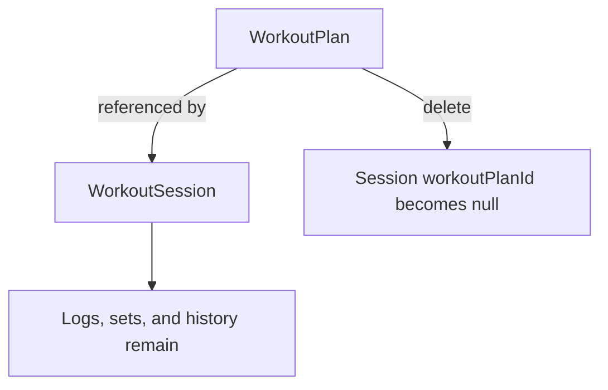

# Workout Plans backend

## Route map

All routes require authentication.

User and discovery routes under `/api/v1/workout-plans`:

| Method       | Path                             | Purpose                                 |
| ------------ | -------------------------------- | --------------------------------------- |
| GET          | `/`                              | List owned and visible public plans     |
| GET          | `/templates`                     | List reusable system and user templates |
| GET          | `/:planId`                       | Read ordered plan detail                |
| POST         | `/`                              | Create a private user plan atomically   |
| PATCH        | `/:planId`                       | Update owned plan metadata              |
| DELETE       | `/:planId`                       | Delete an owned plan                    |
| POST         | `/:planId/clone`                 | Clone an owned or public plan           |
| POST         | `/:planId/days`                  | Add a day to an owned plan              |
| PATCH/DELETE | `/days/:dayId`                   | Mutate an owned day                     |
| POST         | `/:planId/days/reorder`          | Reorder the complete day set            |
| POST         | `/days/:dayId/exercises`         | Add a published exercise                |
| PATCH/DELETE | `/exercises/:planExerciseId`     | Mutate an owned planned exercise        |
| POST         | `/days/:dayId/exercises/reorder` | Reorder the complete exercise set       |

Admin routes under `/api/v1/admin/workout-plans`:

| Method | Path                 | Purpose                           |
| ------ | -------------------- | --------------------------------- |
| POST   | `/`                  | Create a system-owned aggregate   |
| PATCH  | `/:planId`           | Update system-plan metadata       |
| DELETE | `/:planId`           | Delete a system plan              |
| POST   | `/:planId/publish`   | Publish a structurally valid plan |
| POST   | `/:planId/unpublish` | Remove a plan from discovery      |

## Aggregate model

Plan days and exercises cascade when their aggregate root is deleted. Exercise references use `NoAction`, preventing referenced exercises from being deleted. Workout sessions use `SetNull`, preserving workout history.

## Ownership and visibility

- A user plan has `userId = authenticated user` and is private by default.
- A system plan has `userId = null` and can only be created or changed through ADMIN routes.
- Normal clients cannot submit `userId` or `isPublic`.
- Read, clone, and Weight Tracker visibility is exactly: owned by the caller or `isPublic = true`.
- Another user's private plan and an unpublished system draft return the same safe 404.
- Admin system routes intentionally do not mutate user-owned plans.

Summary responses expose `USER`, `SYSTEM`, or `PUBLIC` ownership. Templates additionally expose `SYSTEM_TEMPLATE` or `USER_TEMPLATE`.

## Template behavior

The template endpoint includes public templates and the authenticated user's private templates. It never returns another user's private template. `isTemplate` is reusable metadata; it does not make a plan public.

## Nested creation

User and admin creation share one nested validator and aggregate writer. Exercise IDs are deduplicated and checked in one query for published status. The root, days, and exercises are written in a single transaction, so invalid references or database conflicts leave no partial plan.

Limits include 14 submitted days, 50 exercises per day, 120-character names, 2,000-character descriptions/notes, and bounded set/rest/repetition prescriptions. Because the weekly model permits each `DayOfWeek` only once, a valid plan has at most seven weekly rows even though the transport limit protects request size independently.

Non-rest training days may be empty while a user builds a draft. Publication is stricter.

## Weekly and rest-day invariants

The database enforces unique `(workoutPlanId, dayOfWeek)` and `(workoutPlanId, orderIndex)`. Each weekday therefore appears at most once.

A rest day cannot contain exercises. Nested requests are rejected during validation. Converting an existing populated training day to rest returns 409 and requires explicit exercise removal; the API never silently deletes prescriptions.

## Exercise validation and ordering

New and replacement exercise references must be published. Plan detail embeds only ID, name, primary muscle, subgroup, equipment, and thumbnail.

Reorder requests must contain the complete child set with unique contiguous positions starting at zero. The reusable reorder engine validates membership, temporarily shifts existing positions beyond the allowed range, and applies final positions sequentially in one transaction. This avoids temporary unique-index collisions and makes results deterministic.

## Clone workflow

Clone content and ordering are preserved, but every aggregate ID is regenerated. The clone always uses the authenticated user, `isPublic = false`, and `isTemplate = false`. Unpublishing or deleting the source later does not change the clone.

## Publication lifecycle

Publishing is ADMIN-only and requires:

- at least one day;
- at least one training day;
- every training day populated;
- no exercises on rest days;
- every referenced exercise still published.

Unpublishing removes discovery and new Weight Tracker access. Existing clones and historical sessions remain independent.

## Deletion and Workout Tracker compatibility

Owners may delete only their user plans; admins may delete only system plans. Child rows cascade. Historical sessions retain their logs and sets while `workoutPlanId` becomes null.

Weight Tracker accepts owned plans and public plans, including public system templates. It rejects private plans belonging to others and unpublished system drafts.

## Pagination, filtering, and statistics

Reads are bounded. Listing supports search, difficulty, template state, ownership, stable sorting, and pagination. Templates support search, difficulty, stable sorting, and pagination. Structural statistics are derived from selected child counts and are not persisted: total days, training days, rest days, and total exercises. Relation data is selected in batches, avoiding per-plan queries.

## Security boundaries

- Authentication supplies every user ID.
- Strict Zod schemas reject unknown ownership/publication fields.
- UUIDs, enums, text, pagination, ordering, and nested sizes are bounded.
- Private existence is concealed with safe 404 responses.
- Known uniqueness and foreign-key conflicts become safe application errors.
- Prisma types remain inside the API; public contracts live in `@metaform/shared-types`.
- No raw SQL is used by application code.

## Schema and indexes

Existing weekly/order unique constraints, child cascades, and session `SetNull` behavior were retained. Migration `20260807040000_add_workout_plan_discovery_indexes` adds:

- `(userId, updatedAt DESC)` for owned-plan discovery;
- `(isPublic, isTemplate, difficultyLevel)` for public/template filtering.

## Known limitations and frontend integration

- The requested route map has no admin child-mutation endpoints, so system structures are supplied during nested creation before publication.
- Plans are weekly templates, not calendar schedules.
- There is no collaborative sharing, recommendation engine, or AI generation.
- Future drag-and-drop clients should send complete contiguous reorder arrays after local movement and use returned ordered detail as the source of truth.
