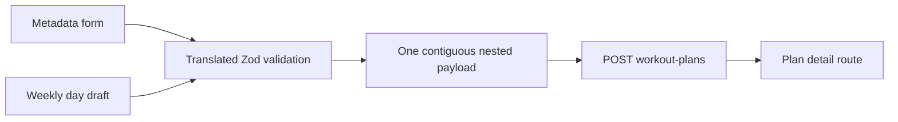
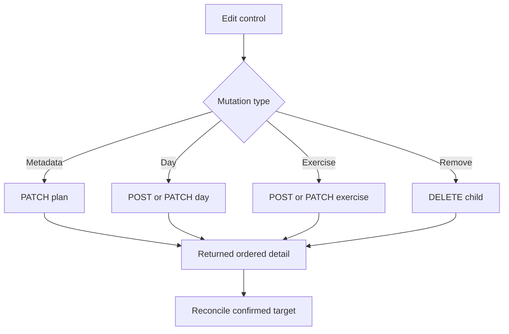
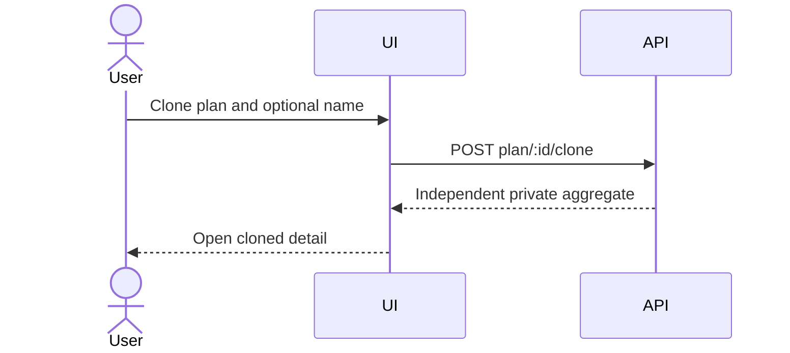
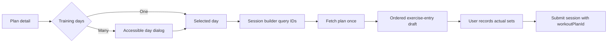

# Workout Plans frontend

## Routes

All routes remain below the existing authenticated application shell:

| Route                     | Purpose                                        |
| ------------------------- | ---------------------------------------------- |
| `/app/plans`              | Ready-made discovery and owned-plan list       |
| `/app/plans/new`          | Transactional nested plan creation             |
| `/app/plans/:planId`      | Read-only ordered plan detail and plan actions |
| `/app/plans/:planId/edit` | Owner-only focused editing                     |

The frontend shows ownership controls only for `ownershipType === USER`. The API remains the authorization authority and safely handles private, missing, and forbidden resources.

## Feature architecture

`features/workout-plans` separates pages, presentation components, async hooks, the authenticated API service, draft types, translated Zod schemas, and pure query/payload/order/reconciliation utilities. Exercise selection reuses the Exercise Library's bounded `useExerciseOptions` hook and `/exercises/options`; plan code does not duplicate exercise search. Picker input is debounced and exposes localized loading, empty, safe error, and retry states.

## Discovery and ownership

Ready-made plans use `/workout-plans/templates`. My Plans uses `/workout-plans?ownership=mine`. Both queries are bounded to 12 items, debounce search, reset pagination when filters change, and preserve stable backend sorting. System templates, user templates, public plans, and normal owned plans have distinct localized labels. Public/system plans never expose edit or delete controls.

## Create flow

React Hook Form owns plan metadata and a typed local draft owns weekly days and prescriptions. A translation-aware Zod schema verifies names, notes, prescriptions, weekday uniqueness, and rest-day invariants. Creation sends one nested request and preserves the draft after recoverable failure.

## Edit mutation flow

Metadata, individual days, and individual prescriptions have separate save ownership. New children call create endpoints; existing children call patch endpoints. Remove actions call their matching delete endpoints. Returned detail updates the confirmed aggregate and reconciles only the mutated draft target, preserving unrelated unsaved edits.

New days and exercises are appended using the next free server order position and cannot be reordered until they have a server ID. This prevents create requests from colliding with occupied positions after a prior deletion. Focused update requests do not include `orderIndex`; ordering is owned exclusively by the complete reorder endpoints. An unsaved edit-mode day must be saved before exercises can be added, so returning aggregate data cannot discard local child drafts.

Changing a populated training day to rest always opens an explicit confirmation. After confirmation, persisted prescriptions are removed through focused endpoints before the day is changed. Cancellation leaves the day and exercises intact.

Because the backend exposes focused child mutations rather than one transactional rest-conversion endpoint, the frontend reloads the confirmed aggregate if any step fails. This makes a partial server mutation visible and retryable instead of leaving a stale local rest-day draft.

## Reordering

Move Up and Move Down controls are the primary reorder interaction. They work with keyboards, screen readers, pointer, touch, LTR, and RTL without an extra drag-and-drop dependency. The pure order utility never reverses sequences for RTL. Persisted reorders send the complete child membership with contiguous zero-based positions. The UI adopts only the returned detail; a failed request therefore retains/restores the previous server-confirmed order.

## Templates, cloning, and deletion

Cloning uses a localized accessible dialog with an optional name. The new plan is a private, non-template user-owned aggregate and the source is unchanged.

Deleting is shown only for owned plans. Confirmation explicitly explains that the plan structure is removed while completed Weight Tracker history remains preserved through the backend's nullable plan relationship.

## Plan to Weight Tracker flow

A plan is a prescription; a session is performed data. Starting a single training-day plan navigates directly. Multiple training days open a localized selector that excludes rest days.

`planDayId` is used only to choose prefill content because sessions do not store that field. `workoutPlanId` is submitted. Planned set counts create editable empty actual sets; numeric planned reps may prefill reps, while ranges remain visible guidance. Plan notes and prescription guidance remain UI-only and are not submitted as performed-session notes. Changing the entry source clears incompatible plan guidance while preserving set drafts. Editing session data never calls a plan mutation.

## Internationalization and RTL

The `workoutPlans` namespace exists in English and Arabic. It covers discovery, filters, ownership, weekdays, forms, validation, dialogs, reordering, states, and Start Workout. API enum values and user/backend-authored plan and exercise names are unchanged. Layout uses logical directions and DOM/order-index sequence remains identical in RTL.

## Accessibility and responsive behavior

- Native labeled inputs, selects, tabs, checkboxes, and modal dialogs are keyboard accessible. Dialogs use `showModal`, support Escape, move initial focus inside, and make the background inert in supported browsers.
- Reorder buttons have item-specific accessible names and disabled boundary states.
- Loading uses status semantics; safe errors use alerts and focusable retry buttons.
- Cards use responsive one-, two-, and three-column grids.
- Editors stack on mobile, avoid fixed data tables, and keep controls touch friendly.
- Media fallbacks have text alternatives.

## Known limitations

- Weekly uniqueness means the effective UI maximum is seven even though the transport safety limit is 14.
- There is no calendar scheduling, reminders, sharing, AI generation, or draft persistence.
- Drag gestures are intentionally omitted; accessible move controls provide deterministic reordering.
- Plan content and exercise names are displayed in their stored backend language.

## Extension guidelines

Add future plan fields to shared contracts first, then service inputs, schema factories, payload utilities, both translation resources, and mocked tests. Keep planning separate from performed-session data. New reorder interactions must still send complete contiguous lists and retain keyboard controls. Future AI Coach reuse should consume plan contracts through a separate feature boundary and must not bypass ownership or publication rules.
